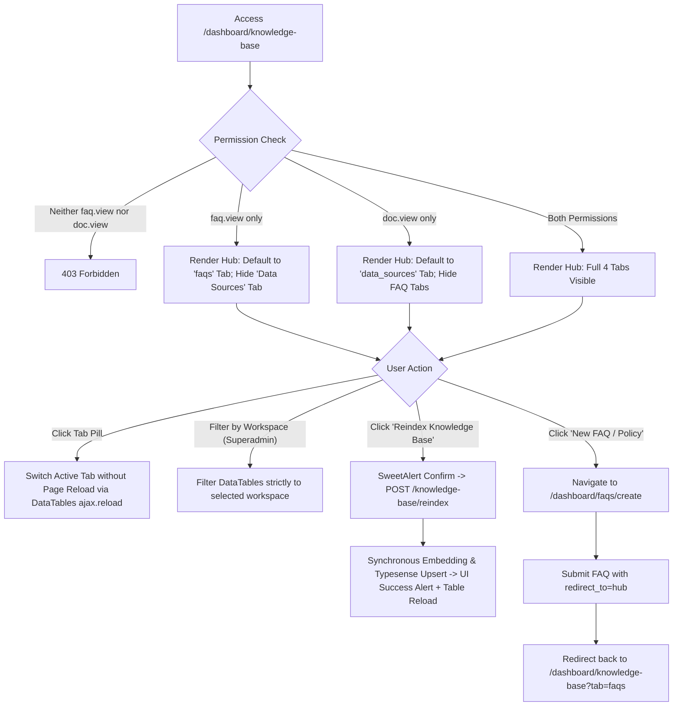
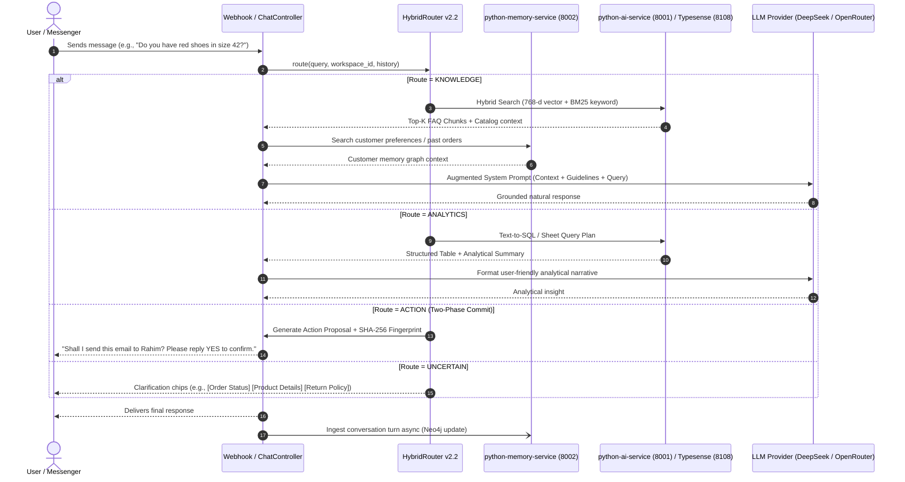

# 02. Application Flow & User Journeys (AppFlow)

> **Status**: CURRENTLY_VERIFIED  
> **Source of Truth**: Reverse-engineered from `routes/web.php`, Blade views (`resources/views/admin/`), and Controller dispatchers.  
> **Last Updated**: October 2026  

---

## 1. Global Route Map & Access Control Matrix

All dashboard routes reside under the `/dashboard` prefix and require the `auth` middleware. Access is strictly guarded by Spatie permissions and multi-tenant scoping.

```
/ (Home / Landing)
├── /health (Unauthenticated Health Check -> HealthController)
├── /webhook (Omni-channel Webhook: Facebook/Messenger/External)
└── /dashboard (Prefix: auth)
    ├── / (DashboardController::dashboard)
    ├── /cache-clear (DashboardController::cacheClear)
    │
    ├── /simulator (ChatSimulatorController::index)
    │   ├── POST /simulator/send (throttle: 60,1)
    │   ├── POST /simulator/clear
    │   ├── POST /simulator/clear-excel
    │   ├── POST /simulator/select-source
    │   └── POST /simulator/switch-workspace
    │
    ├── /knowledge-base (KnowledgeBaseController::index -> Hub [faqs, policies, business_info, data_sources])
    │   └── POST /knowledge-base/reindex (KnowledgeBaseController::reindex -> Direct Vector Sync)
    │
    ├── /faqs (FAQController Resource)
    │   ├── GET  /faqs/create
    │   ├── POST /faqs (redirect_to=hub -> redirect to /dashboard/knowledge-base?tab=faqs)
    │   ├── GET  /faqs/{id}/edit
    │   ├── PUT  /faqs/{id}
    │   ├── POST /faqs/{id}/toggle-active
    │   ├── POST /faqs/{id}/resync
    │   ├── POST /faqs/{id}/restore
    │   └── POST /faqs/bulk-delete
    │
    ├── /documents (KnowledgeDocumentController Resource)
    │   ├── GET  /documents/create
    │   ├── POST /documents (redirect_to=hub -> redirect to /dashboard/knowledge-base?tab=data_sources)
    │   ├── POST /documents/{id}/retry
    │   ├── POST /documents/{id}/restore
    │   ├── POST /documents/{id}/update-purpose
    │   └── GET  /documents/{id}/preview
    │
    ├── /conversations (ConversationController)
    │   ├── GET  /conversations
    │   ├── GET  /conversations/{id}
    │   ├── POST /conversations/{id}/reply
    │   └── POST /conversations/{id}/ai-reply
    │
    ├── /export/conversation/{conversation}/{format} (ExportController::exportConversation)
    ├── /export/analytics (ExportController::exportAnalytics)
    ├── /observability (ObservabilityController::index)
    │
    ├── /users (UserController Resource)
    ├── /roles (RoleController Resource)
    ├── /assign-roles (AssignRoleController Resource)
    └── /message (ContactFormController)
```

---

## 2. Core User Journeys & State Transitions

### 2.1 Unified Knowledge Base Hub Journey



#### Detailed Actions & State Responses in Hub:
1. **Toggle Active Status (`POST /dashboard/faqs/{faq}/toggle-active`)**:
   - Updates `is_active` boolean in MySQL.
   - Dispatches Typesense sync/removal job or executes immediate vector change.
   - Returns JSON `{ success: true, is_active: bool, status: string }`.
2. **Resync Single FAQ (`POST /dashboard/faqs/{faq}/resync`)**:
   - Sets FAQ state to `syncing`, acquires per-record lock, calls `RetrievalClient::syncFaq`.
   - On success: updates to `active` with timestamp.
   - On error: updates to `sync_failed` with error message.
3. **Reindex Knowledge Base (`POST /dashboard/knowledge-base/reindex`)**:
   - Button located in the Hub action header.
   - Protected by `faq.update | faq.create` permissions.
   - Iterates through active FAQs in the target workspace and pushes vector embeddings to Typesense.
   - Shows spinner animation (`ri-spin`) during processing; disables button to prevent double submission.
4. **Document Preview (`GET /dashboard/documents/{document}/preview`)**:
   - Displays modal with parsed sheets, total rows, detected column types, and first 10 rows.
   - Protected by `knowledge_document.view` permission.

---

### 2.2 Customer Chat & Autonomous Support Agent Flow



---

### 2.3 Interactive Chat Simulator Journey (`/dashboard/simulator`)

The Simulator is an internal diagnostic console allowing admins to test the complete conversational pipeline without connecting a live social media page:
* **Source Scoping**: Allows selecting specific uploaded Excel data sources or running against the entire knowledge base.
* **Workspace Scoping**: Superadmins can toggle between active workspaces on the fly.
* **Turn-by-turn Telemetry**: Displays the exact route selected (`KNOWLEDGE`, `ANALYTICS`, `CONVERSATIONAL`, `ACTION`), confidence score, LLM token usage, retrieval latency, and active memory items.
* **Clearing & Resetting**:
  - `POST /simulator/clear`: Wipes session messages and resets ephemeral conversation state.
  - `POST /simulator/clear-excel`: Disassociates explicit spreadsheet file binding from the session.

---

## 3. Error Handling, Empty States & Boundary Behaviors

| Scenario | System Behavior | User / Client Experience |
| :--- | :--- | :--- |
| **Unauthenticated Request** | Redirects to `/login` for web requests; returns `401 Unauthorized` for JSON endpoints. | User sees login page with redirect intent preserved. |
| **Unauthorized Resource Access** | Checks granular permission (`faq.view`, `knowledge_document.view`). Returns HTTP 403 Forbidden. | AJAX DataTables request renders empty error alert; Web request shows `403 Forbidden` error page. |
| **Cross-Tenant Access Attempt** | Eloquent query enforces `where('workspace_id', $authWorkspaceId)`. If nonexistent in tenant, returns HTTP 404 ModelNotFound. | Prevents data leakage; user sees standard "Record Not Found" alert. |
| **Empty Knowledge Base Tab** | DataTables returns 0 records. | Table displays custom empty state: *"No matching records found. Click 'New FAQ / Policy' to get started."* |
| **Typesense Outage / Unreachable** | `RetrievalClient` catches Guzzle / ConnectException; activates relational fallback (`BusinessSourceOfTruthService` + MySQL). | Chatbot continues functioning in degraded mode using database text search. Observability logs error. |
| **Neo4j Memory Service Degraded** | `ConversationMemoryClient` timeout enforced (3 seconds). Fails gracefully to empty memory context. | Chat pipeline completes without long-term memory; chat response is not blocked. |
