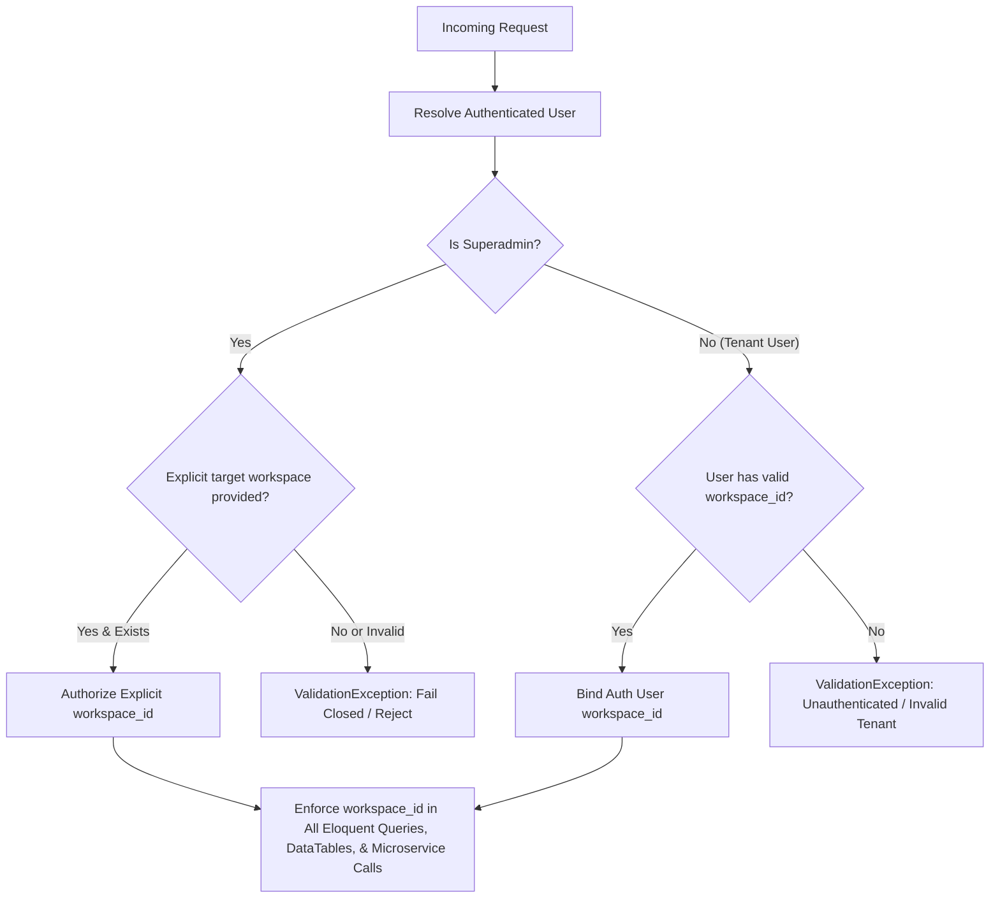

# 04. Technical Requirements & Architecture Document (TRD)

> **Status**: CURRENTLY_VERIFIED  
> **Source of Truth**: Reverse-engineered from codebase, `composer.json`, `package.json`, microservice implementations, and configuration files.  
> **Last Updated**: October 2026  

---

## 1. System Architecture Overview & Topology

The platform operates as a modular, distributed multi-service architecture comprising a primary Laravel 12 web and API orchestrator, two high-performance Python FastAPI microservices, and dedicated search and graph persistence engines.

```
+-----------------------------------------------------------------------------------------+
|                                     Client Tier                                         |
|      (Web Browser / Admin UI, Facebook Messenger Webhooks, Public Chat Simulator)        |
+--------------------------------------------+--------------------------------------------+
                                             | HTTP / HTTPS / JSON
                                             v
+-----------------------------------------------------------------------------------------+
|                  multi-source-chatbot (Primary Laravel 12 Application)                  |
|  - Web / API Routing & Controllers (KnowledgeBaseController, FAQController, Chat, etc.)  |
|  - Multi-Tenant Scoping & Spatie RBAC                                                   |
|  - HybridRouter v2.2 (Fast LLM Semantic Intent Routing)                                 |
|  - Agent Orchestration (CustomerSupportService, KnowledgeSupportAgent)                  |
|  - Relational Database Persistence (MySQL 8.0)                                          |
|  - Background Queue & Job Execution (Horizon / Database Driver)                         |
+-------------------+------------------------------------+--------------------------------+
                    |                                    |
                    | HTTP (Port 8001)                   | HTTP (Port 8002)
                    v                                    v
+-----------------------------------+   +-------------------------------------------------+
|        python-ai-service          |   |              python-memory-service              |
|  - Port 8001 (FastAPI)            |   |  - Port 8002 (FastAPI)                          |
|  - Dense Embeddings (768-d)       |   |  - Long-Term Customer Memory Graph              |
|  - Typesense Hybrid Search Engine |   |  - Preference & Entity Extraction               |
|  - Text-to-SQL Analytics Engine   |   |  - Temporal Graph Traversal                     |
|  - Spreadsheet (Excel/CSV) Engine |   +------------------------+------------------------+
+-----------------+-----------------+                            |
                  |                                              | Bolt (Port 7687)
                  | HTTP (Port 8108)                             v
                  v                             +---------------------------------+
+-----------------------------------+           |      Neo4j 5 Community          |
|      Typesense Search Engine      |           |  - Bolt Port 7687               |
|  - Port 8108 (Docker)             |           |  - HTTP Browser Port 7474       |
|  - Hybrid Vector + BM25 Indexes   |           |  - APOC Graph Procedures        |
+-----------------------------------+           +---------------------------------+
```

---

## 2. Framework & Dependency Versions

### 2.1 Backend (Laravel Ecosystem)
* **PHP Runtime**: `^8.2` (Strict typing enabled across service layer).
* **Laravel Framework**: `^12.0` (Latest LTS architecture).
* **Key Packages**:
  - `spatie/laravel-permission`: `^6.25` (Role and permission matrix).
  - `yajra/laravel-datatables`: `^12` (Server-side tabular data processing).
  - `maatwebsite/excel`: `^3.1` (Spreadsheet import/export).
  - `barryvdh/laravel-dompdf`: `^3.1` (PDF conversation and analytics report generation).
  - `laravel/socialite`: `^5.31` (OAuth & social login integrations).
  - `laravel/ai`: `*` (Official Laravel AI SDK abstraction).

### 2.2 Frontend & Build Tools
* **Node Environment**: Node 20+.
* **Bundler**: `vite` `^7.0.7` via `laravel-vite-plugin` `^2.0.0`.
* **Styling**: `sass` `^1.81.0`, `tailwindcss` `^3.1.0` (Scoped utility integration), `@tailwindcss/vite` `^4.0.0`.
* **Scripting**: `alpinejs` `^3.4.2`, `axios` `^1.11.0`, vanilla modern JS.

### 2.3 Microservice Runtimes & Infrastructure
* **Python Runtime**: Python `3.12+`.
* **FastAPI**: `^0.110+` with Pydantic v2.
* **Vector Store**: Typesense `29.0` running via Docker container on port `8108`.
* **Graph Database**: Neo4j `5-community` with APOC plugin running via Docker container on ports `7474` (HTTP) and `7687` (Bolt).
* **Relational Database**: MySQL `8.0+` (InnoDB engine, `utf8mb4_unicode_ci`).

---

## 3. Microservice Contracts & API Endpoints

### 3.1 `python-ai-service` (Port 8001)

#### A. Health & Diagnostics
* **`GET /health`** (or `/api/v1/health`): Returns model status, embedding dimension (`768`), device (`cpu`/`cuda`), Typesense connection state, and uptime.

#### B. Knowledge Base & Vector Retrieval
* **`POST /api/v1/search`**:
  - Request: `{ query: string, workspace_id: int, top_k: int, contextual_signal?: string }`
  - Response: `{ hits: [{ id, question, answer, score, document_type, priority }], total: int }`
* **`POST /api/v1/faqs/sync`**:
  - Request: `{ id: int, workspace_id: int, question: string, answer: string, priority: int, is_active: bool, document_type: string, lexicon_terms: string[] }`
  - Action: Generates 768-d embedding for `question + answer` and upserts into Typesense.
  - Response: `{ status: "synced", id: string, workspace_id: int }`
* **`DELETE /api/v1/faqs/{faq_id}`**:
  - Deletes FAQ document and vector embedding from Typesense collection.

#### C. Generic Analytics & Spreadsheet Query
* **`POST /analytics/query`**:
  - Request: `{ query: string, workspace_id: int, engine: "semantic"|"excel"|"data_source", file_id?: string, history?: array }`
  - Execution: Pass through SemanticPlanner -> Validator -> AST Compiler -> Safe Executor.
  - Response: `{ success: bool, intent: string, report: string, sql?: string, rows?: array, is_security_rejection: bool, clarification_options?: array }`

---

### 3.2 `python-memory-service` (Port 8002)

#### A. Health Check
* **`GET /health`**: Returns Neo4j connectivity status and service metadata.

#### B. Memory Ingestion & Graph Retrieval
* **`POST /memory/ingest`**:
  - Request: `{ workspace_id: int, customer_id: string, conversation_id: int, channel: string, messages: array }`
  - Execution: Upserts `Customer` and `Conversation` nodes; links via `[:PARTICIPATED_IN]`; extracts preferences and unresolved issues via LLM/NER; upserts graph relationships.
  - Response: `{ success: bool, edges_created: int, memories_stored: int }`
* **`POST /memory/search`**:
  - Request: `{ workspace_id: int, customer_id: string, query: string, limit?: int }`
  - Response: `{ memories: [{ category, value, confidence, timestamp }], customer_summary: string }`

---

## 4. Multi-Tenant Isolation & Security Controls



### Security Invariants:
1. **Zero-Implicit-Tenant Policy**: The system never defaults to workspace `1` or infers an arbitrary workspace when tenant context is missing. Missing workspace context **fails closed** immediately.
2. **Resource-Level Authorization**: Routes and DataTables dispatchers check Spatie permissions (`faq.view`, `knowledge_document.view`, `faq.update`, etc.). Unauthorized requests receive HTTP 403.
3. **AST SQL Compiler**: The analytics service never allows an LLM to generate or execute raw SQL strings. Queries compile to read-only ASTs with strict whitelisted functions (`SUM`, `COUNT`, `AVG`, `MIN`, `MAX`) and tenant filtering.
4. **Action Safety (Two-Phase Commit)**: Modifying actions (such as sending an email to a salesperson) generate a cryptographically signed SHA-256 fingerprint. The execution step only proceeds if the fingerprint matches the pending session state.

---

## 5. Development & Service Orchestration

### Starting the Local Ecosystem
1. **Typesense & Neo4j**:
   ```bash
   cd typesense && docker compose up -d
   ```
2. **Python AI Service (Embedding & Analytics)**:
   ```bash
   cd python-ai-service
   source venv/bin/activate
   uvicorn app.main:app --host 127.0.0.1 --port 8001 --reload
   ```
3. **Python Memory Service (Graph Memory)**:
   ```bash
   cd python-memory-service
   source venv/bin/activate
   uvicorn app.main:app --host 127.0.0.1 --port 8002 --reload
   ```
4. **Laravel Application (Web, Queue, Vite)**:
   ```bash
   cd multi-source-chatbot
   composer run dev
   ```

---

## 6. Known Technical Debt & Decommissioned Artifacts

1. **Decommissioned Services**:
   - `python-ingestion-worker`: Fully removed; spreadsheet ingestion unified into `python-ai-service`.
   - `python-langchain-service`: Research concluded; `LangChainRouter` removed; production standardized on native PHP `HybridRouter`.
2. **In-Memory Collection Processing vs Query Builders**:
   - DataTables queries for FAQs and Knowledge Documents have been refactored from `->get()` in-memory processing to native query builders (`DataTables::of($query)`) to ensure optimal memory usage at scale.
3. **Fallback Resiliency**:
   - When Typesense is offline, `BusinessSourceOfTruthService` provides MySQL full-text search fallback. Ensure database indexes on `faqs (question, answer)` are maintained.
