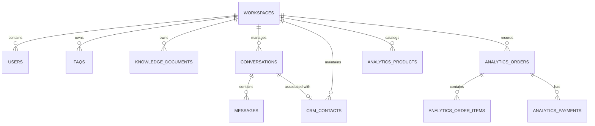

# 05. Database Schema & Data Models (Schema)

> **Status**: CURRENTLY_VERIFIED  
> **Source of Truth**: Reverse-engineered from `database/migrations/` and Eloquent models in `app/Models/`.  
> **Last Updated**: October 2026  

---

## 1. Multi-Tenant Architecture & Workspace Scoping

All primary business records, knowledge entries, and customer communications include a foreign key reference to `workspaces.id`. Every tenant operation is strictly filtered by `workspace_id`.

---

## 2. Comprehensive Table Definitions

### 2.1 Multi-Tenancy & User Management

#### `workspaces`
* **Migration**: `0001_01_00_000000_create_workspaces_table.php`
* **Model**: `App\Models\Workspace`
| Column | Type | Attributes | Description |
| :--- | :--- | :--- | :--- |
| `id` | `BIGINT UNSIGNED` | Primary Key, Auto-increment | Unique workspace identifier |
| `name` | `VARCHAR(255)` | Not Null | Business or brand name |
| `slug` | `VARCHAR(255)` | Unique, Not Null | URL-safe identifier |
| `domain` | `VARCHAR(255)` | Nullable | Custom custom domain mapping |
| `is_active` | `TINYINT(1)` | Default: `1` | Active billing/system status |
| `created_at`, `updated_at` | `TIMESTAMP` | Nullable | Standard timestamps |

#### `users`
* **Migration**: `0001_01_01_000000_create_users_table.php`
* **Model**: `App\Models\User`
| Column | Type | Attributes | Description |
| :--- | :--- | :--- | :--- |
| `id` | `BIGINT UNSIGNED` | Primary Key, Auto-increment | User identifier |
| `workspace_id` | `BIGINT UNSIGNED` | Nullable, Indexed, FK -> `workspaces(id)` | Tenant binding (Null for Superadmin) |
| `name` | `VARCHAR(255)` | Not Null | User full name |
| `email` | `VARCHAR(255)` | Unique, Not Null | Email address |
| `password` | `VARCHAR(255)` | Not Null | Bcrypt hashed password |
| `email_verified_at` | `TIMESTAMP` | Nullable | Email verification timestamp |
| `created_at`, `updated_at` | `TIMESTAMP` | Nullable | Standard timestamps |

---

### 2.2 Knowledge Base & Ingestion Hub

#### `faqs`
* **Migration**: `2026_07_08_000002_create_faqs_table.php`
* **Model**: `App\Models\FAQ`
| Column | Type | Attributes | Description |
| :--- | :--- | :--- | :--- |
| `id` | `BIGINT UNSIGNED` | Primary Key, Auto-increment | FAQ record ID |
| `workspace_id` | `BIGINT UNSIGNED` | Not Null, Indexed, FK -> `workspaces(id)` | Tenant ownership |
| `question` | `TEXT` | Not Null | The user query or question title |
| `answer` | `MEDIUMTEXT` | Not Null | Grounded response body |
| `document_type` | `VARCHAR(50)` | Default: `'faq'`, Indexed | `'faq'`, `'policy'`, `'business_info'`, `'customer_support'` |
| `is_active` | `TINYINT(1)` | Default: `1`, Indexed | Whether the FAQ is active in search |
| `priority` | `INT` | Default: `0`, Indexed | Higher values prioritize hit rankings |
| `indexing_status` | `VARCHAR(30)` | Default: `'active'` | `'active'`, `'syncing'`, `'sync_failed'`, `'draft'` |
| `typesense_id` | `VARCHAR(255)` | Nullable, Indexed | External Typesense vector document ID |
| `deleted_at` | `TIMESTAMP` | Nullable | Soft-delete timestamp |
| `created_at`, `updated_at` | `TIMESTAMP` | Nullable | Standard timestamps |

#### `knowledge_documents`
* **Migration**: `2026_10_14_000001_create_knowledge_documents_table.php`
* **Model**: `App\Models\KnowledgeDocument`
| Column | Type | Attributes | Description |
| :--- | :--- | :--- | :--- |
| `id` | `BIGINT UNSIGNED` | Primary Key, Auto-increment | Document ID |
| `workspace_id` | `BIGINT UNSIGNED` | Not Null, Indexed, FK -> `workspaces(id)` | Tenant ownership |
| `user_id` | `BIGINT UNSIGNED` | Not Null, FK -> `users(id)` | Uploading user ID |
| `title` | `VARCHAR(255)` | Not Null | Display title of document |
| `file_name` | `VARCHAR(255)` | Not Null | Original filename on upload |
| `file_path` | `VARCHAR(500)` | Not Null | Storage disk path |
| `file_type` | `VARCHAR(50)` | Not Null | MIME / Extension (`csv`, `xlsx`, `xls`) |
| `file_size` | `BIGINT UNSIGNED` | Not Null | File size in bytes |
| `purpose` | `VARCHAR(50)` | Default: `'data_analytics'`, Indexed | Strictly `'data_analytics'` for Hub |
| `sheet_count` | `INT` | Default: `1` | Detected sheets in workbook |
| `row_count` | `INT` | Default: `0` | Parsed rows count |
| `metadata` | `JSON` | Nullable | Parsed schema, columns, summary |
| `status` | `VARCHAR(30)` | Default: `'active'` | Lifecycle status |
| `deleted_at` | `TIMESTAMP` | Nullable | Soft-delete timestamp |
| `created_at`, `updated_at` | `TIMESTAMP` | Nullable | Standard timestamps |

---

### 2.3 Conversation & Messaging Engine

#### `conversations`
* **Migration**: `2026_07_01_061636_create_conversations_table.php`
* **Model**: `App\Models\Conversation`
| Column | Type | Attributes | Description |
| :--- | :--- | :--- | :--- |
| `id` | `BIGINT UNSIGNED` | Primary Key, Auto-increment | Conversation ID |
| `workspace_id` | `BIGINT UNSIGNED` | Not Null, Indexed, FK -> `workspaces(id)` | Tenant ownership |
| `channel_account_id`| `BIGINT UNSIGNED` | Nullable, FK -> `channel_accounts(id)` | Connected Facebook Page / Channel |
| `contact_id` | `BIGINT UNSIGNED` | Nullable, FK -> `crm_contacts(id)` | Linked CRM contact profile |
| `external_user_id` | `VARCHAR(255)` | Nullable, Indexed | External channel user ID (e.g., PSID) |
| `status` | `VARCHAR(30)` | Default: `'open'` | `'open'`, `'resolved'`, `'pending'` |
| `last_message_at` | `TIMESTAMP` | Nullable, Indexed | Timestamp of last message in thread |
| `created_at`, `updated_at` | `TIMESTAMP` | Nullable | Standard timestamps |

#### `messages`
* **Migration**: `2026_07_01_061636_create_messages_table.php`
* **Model**: `App\Models\Message`
| Column | Type | Attributes | Description |
| :--- | :--- | :--- | :--- |
| `id` | `BIGINT UNSIGNED` | Primary Key, Auto-increment | Message ID |
| `conversation_id` | `BIGINT UNSIGNED` | Not Null, Indexed, FK -> `conversations(id)` | Parent conversation |
| `sender_type` | `VARCHAR(30)` | Not Null | `'user'` (shopper), `'bot'` (AI), `'agent'` (human) |
| `sender_id` | `VARCHAR(255)` | Nullable | Sender identifier |
| `body` | `TEXT` | Not Null | Message body content |
| `metadata` | `JSON` | Nullable | Route telemetry, token usage, tool calls |
| `created_at`, `updated_at` | `TIMESTAMP` | Nullable | Standard timestamps |

---

### 2.4 Structured Business Analytics Domain (`analytics_*`)

Used by the Python Analytics Text-to-SQL service for deterministic business queries:

* **`analytics_salespersons`**: `id`, `workspace_id`, `name`, `email`, `phone`, `code`, `target_amount`.
* **`analytics_customers`**: `id`, `workspace_id`, `name`, `phone`, `email`, `address`, `city`, `total_spent`.
* **`analytics_products`**: `id`, `workspace_id`, `name`, `sku`, `category`, `price`, `stock_quantity`, `description`.
* **`analytics_orders`**: `id`, `workspace_id`, `customer_id`, `salesperson_id`, `order_number`, `order_date`, `total_amount`, `paid_amount`, `status`.
* **`analytics_order_items`**: `id`, `order_id`, `product_id`, `quantity`, `unit_price`, `subtotal`.
* **`analytics_payments`**: `id`, `workspace_id`, `order_id`, `amount`, `payment_method`, `transaction_reference`, `payment_date`.
* **`analytics_due_assignments`**: `id`, `workspace_id`, `customer_id`, `salesperson_id`, `due_amount`, `assigned_date`, `status`.

---

## 3. Spatie Role-Based Access Control (RBAC) Tables

Configured via `spatie/laravel-permission` (`2026_07_05_101729_create_permission_tables.php`):
* **`roles`**: `id`, `name`, `guard_name` (`web`). Standard roles: `superadmin`, `admin`, `agent`, `user`.
* **`permissions`**: Granular resource permissions:
  - `faq.view`, `faq.create`, `faq.update`, `faq.delete`
  - `knowledge_document.view`, `knowledge_document.create`, `knowledge_document.update`, `knowledge_document.delete`
  - `conversation.view`, `conversation.update`
  - `user.view`, `user.create`, `user.update`, `user.delete`
  - `role.view`, `role.create`, `role.update`, `role.delete`
* **Pivot Tables**: `model_has_roles`, `model_has_permissions`, `role_has_permissions`.
