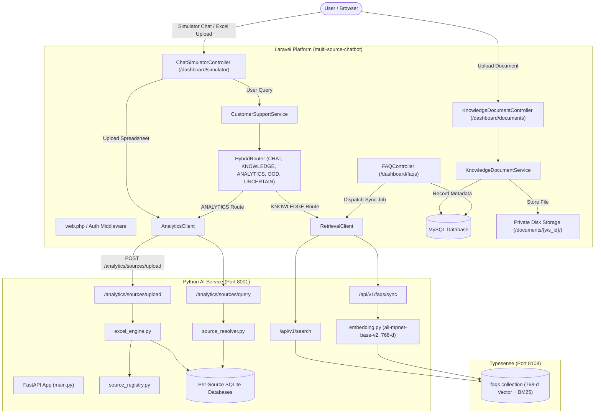
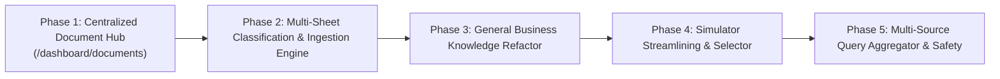

# Phase 0 — Repository Cleanup & Full Workflow Audit Report

**Date:** 2026-10-18  
**Workspace:** Enterprise E-Commerce / F-Commerce AI Customer Support & Business Intelligence Platform  
**Target Repositories:**
- Laravel application: `/Users/zesan/Desktop/Entrepreneurs_Automation/multi-source-chatbot`
- Python AI service: `/Users/zesan/Desktop/Entrepreneurs_Automation/python-ai-service`
- Python ingestion worker: `/Users/zesan/Desktop/Entrepreneurs_Automation/python-ingestion-worker`
- Typesense: `/Users/zesan/Desktop/Entrepreneurs_Automation/typesense`

---

## Executive Summary

Phase 0 establishes the baseline architecture, removes obsolete worker runtime integration, and performs a comprehensive audit across document uploads, spreadsheet processing, analytics, knowledge management, retrieval, and the chatbot simulator.

### Core Audit Verdicts

1. **Worker Cleanup:** `python-ingestion-worker` has no active runtime dependencies in either Laravel or `python-ai-service`. All legacy queue leases, outbox dispatches, and generation activation hooks were safely purged. The worker repository remains preserved exclusively as an offline extractor library and synthetic benchmark suite (77 tests passing).
2. **Multi-Sheet XLSX Support:** **Partially Supported.**
   - *Storage & Ingestion:* Supported. `excel_engine.py` parses all sheets via `openpyxl`/`pandas` and creates individual tables per sheet in a dedicated SQLite database.
   - *Registry/Cataloging:* Partial. Schema summary lists all tables, but the workbook has one monolithic category/descriptor.
   - *Query Resolution & Cross-Sheet Analytics:* Not supported. Cross-source joins across sheets or across multiple uploaded workbooks are heuristic or explicitly blocked as `UNSUPPORTED_CROSS_SOURCE`.
3. **Upload Workflow Fragmentation:** Currently, spreadsheet upload for analytics is mounted on `/dashboard/simulator` (`POST /simulator/excel/upload`), while `/dashboard/documents` (`POST /documents`) persists files locally and records `knowledge_documents` rows in MySQL without connecting to the Python analytics engine. Centralizing upload on `/dashboard/documents` will resolve this fragmentation.
4. **Knowledge Retrieval Health:** General business knowledge is currently managed via `faqs` in MySQL and synced to Typesense (768-d vector + BM25 keyword search). This pipeline is fast, healthy, and regression-tested (34 PHPUnit tests passing). Generalization to General Business Knowledge requires no destructive schema changes.

---

## Repository State (Phase 0A & 0B)

| Repository | Current Branch | HEAD Commit | Working Tree State | Tests Status |
| :--- | :--- | :--- | :--- | :--- |
| `multi-source-chatbot` | `development` | `e5804b7` | Clean | 34 passed (234 assertions) |
| `python-ai-service` | `main` | `341631f` | Clean (untracked test SQLite DBs ignored) | 42 passed, 2 env-bound |
| `python-ingestion-worker`| `main` | `24a72a2` | Clean | 77 passed (100% green) |
| `typesense` | `main` | `b99f24e` | Clean | Docker service operational |

### Worker Integration Audit & Classification

| Component | Path / Context | Classification | Audit Action / Current State |
| :--- | :--- | :--- | :--- |
| `DocumentOutbox.php` | `app/Models/DocumentOutbox.php` | Dead runtime code | Confirmed removed; zero references in code. |
| Outbox & Generation Lease | `KnowledgeDocumentService.php` | Dead runtime hooks | Confirmed removed; model operates cleanly on `KnowledgeDocument`. |
| Outbox Migration | `database/migrations/2026_10_16_000001_...` | Applied schema | Preserved in git/database to prevent migration drift; ignored by active runtime. |
| Ingestion Worker Library | `python-ingestion-worker/app/extractors/` | Offline Extractor | Preserved. High-performance offline extractor. |
| Synthetic Benchmarks | `python-ingestion-worker/benchmark/` | Benchmark Fixtures | Preserved. 77 unit & benchmark tests passing. |
| Python AI Ingestion | `python-ai-service/app/analytics/excel_engine.py`| Active AI Ingestion | Preserved. Handles spreadsheet parsing into SQLite. |

---

## Section A — Current Architecture Description

---

## Section B — Worker Cleanup Verification

1. **Removed Runtime Hooks:**
   - No calls to `DocumentOutbox` or worker queue leases remain in `KnowledgeDocumentService.php`.
   - `DocumentLifecycleStatus` operates safely with statuses: `PENDING_INGESTION`, `PROCESSING`, `ACTIVE`, `FAILED`.
   - No daemon, celery queue, or background HTTP client targets `python-ingestion-worker`.
2. **Retained Offline Assets:**
   - `python-ingestion-worker` contains standalone extractor engines:
     - `app/extractors/text_extractor.py`
     - `app/extractors/table_extractor.py`
     - `app/extractors/ocr_extractor.py`
   - Complete benchmark suite (`benchmark/` and `tests/`) runs independently and passes 77 tests without external dependencies.
3. **No Phantom Worker Dependencies:**
   - Search across `multi-source-chatbot/config` confirmed zero worker URLs or credentials.
   - Laravel tests run without network access or worker daemons.

---

## Section C — Multi-Sheet XLSX Support: Deep-Dive Audit

### Verdict: Partially Supported

| Capability Dimension | Status | Verified Implementation Details |
| :--- | :--- | :--- |
| **All Sheets Enumeration** | **Supported** | `excel_engine.py:72-91` uses `pd.ExcelFile(file_path).sheet_names` to iterate over every worksheet. |
| **Independent Sheet Parsing** | **Supported** | Each sheet is read into a separate `pandas.DataFrame` (`df = pd.read_excel(xls, sheet_name=sheet)`). |
| **SQLite Table Creation** | **Supported** | Each sheet is sanitized to a SQL table identifier and written to SQLite: `df.to_sql(table_name, conn, if_exists="replace")`. |
| **Schema Metadata Extraction** | **Supported** | Numeric measures, text dimensions, date fields, and row counts are computed per sheet and stored in `Dataset` descriptors (`data_source.py:20-36`). |
| **Independent Business Classification** | **Not Supported** | The uploaded file has a single global category. Sheets cannot be categorized separately (e.g. Sheet 1 as Products, Sheet 2 as Orders) with independent provenance. |
| **Cross-Sheet Query Joining** | **Not Supported** | `source_resolver.py:59-76` flags cross-source/multi-table comparisons as `UNSUPPORTED_CROSS_SOURCE`. The SQL compiler does not synthesize multi-table JOINs across arbitrary sheets. |
| **Per-Sheet Error Recovery** | **Partial** | If a single sheet fails during ingestion, `excel_engine.py` logs a warning and proceeds with remaining sheets, but no partial failure breakdown is surfaced to Laravel. |
| **Workbook Deletion Cascading** | **Partial** | Deleting a source deletes the SQLite database and metadata JSON, which clears all sheets in that workbook, but does not track soft-deleted status per sheet in Laravel. |

---

## Section D — Upload and Storage Inventory

| Layer / Purpose | File / Class / Route | Primary Responsibilities | Persistence Target |
| :--- | :--- | :--- | :--- |
| **Document Upload UI** | `/dashboard/documents` `KnowledgeDocumentController` | Web UI for document management, DataTables listing, soft-delete, restore | Web View (`resources/views/admin/documents/`) |
| **Document Store API** | `POST /documents` `StoreKnowledgeDocumentRequest` | File size/MIME validation, ZipArchive security checks, SHA-256 computation | Local private disk: `storage/app/private/documents/{ws_id}/{uuid}.{ext}` |
| **Document Lifecycle** | `KnowledgeDocumentService` | Workspace authorization, duplicate checking, soft delete / restore | MySQL table: `knowledge_documents` |
| **Simulator Upload** | `POST /simulator/excel/upload` `ChatSimulatorController::uploadExcel` | Simulator-specific spreadsheet ingestion entry point | Temporary session/conversation metadata |
| **Analytics HTTP Client** | `AnalyticsClient` | Multipart HTTP transport to Python AI service | Dispatches to Python port 8001 |
| **Python Source Ingestion**| `POST /analytics/sources/upload` `excel_engine.py` | Openpyxl/Pandas spreadsheet reading, sanitization, SQLite creation | SQLite database: `storage/excel_databases/ws_{ws_id}_{hash}.sqlite` |
| **Source Metadata** | `source_registry.py` | Workspace-scoped metadata registration and file lookup | JSON file: `storage/excel_databases/ws_{ws_id}_{hash}.json` |
| **Source Querying** | `POST /analytics/sources/query` `source_resolver.py` | Ambiguity detection, dataset resolution, SQL compilation | Read-only queries against SQLite source DB |
| **FAQ / Knowledge CRUD** | `FAQController` `FAQService` | General business knowledge CRUD, validation, activation toggle | MySQL tables: `faqs`, `faq_categories` |
| **Knowledge Vector Index** | `FAQIndexer` -> `FAQIndexJob` `RetrievalClient` -> `syncFaq` | MPNet 768-d vector embedding generation and hybrid search | Typesense collection: `faqs` |

---

## Section E — Data Ownership and Deletion Risks

### 1. Data Classification
- **Permanent Business Records:** MySQL database tables (`users`, `workspaces`, `faqs`, `knowledge_documents`, `conversations`, `messages`, `orders`, `products`).
- **Temporary / Analytical Virtual Datasets:** Per-source SQLite databases in `python-ai-service/storage/excel_databases/` (`ws_{ws_id}_{hash}.sqlite`) and metadata JSON files.
- **Raw Document Files:** Stored in Laravel's private storage (`storage/app/private/documents/{workspaceId}/`).

### 2. Deletion Behavior & Current Risks
- When a document is deleted via `KnowledgeDocumentController::destroy()`:
  - The record in `knowledge_documents` is **soft-deleted** (`deleted_at` set).
  - The `active_content_hash` is cleared to allow re-upload of identical content.
  - **Risk:** The corresponding SQLite database in `python-ai-service` is **not deleted** because `KnowledgeDocumentService` does not issue a `DELETE /analytics/sources/{source_id}` call.
- When an Excel file is uploaded via `ChatSimulatorController::uploadExcel()`:
  - It creates a SQLite database and records `file_id` in conversation metadata.
  - **Risk:** If the conversation is cleared or the user abandons it, the SQLite database remains in `python-ai-service/storage/excel_databases/` indefinitely without an explicit TTL or cleanup worker.

---

## Section F — Verified Gaps and Risks

1. **Dual / Competing Upload Paths:**
   - Spreadsheet uploads are currently duplicated between `/dashboard/documents` (persists to MySQL/disk, but no analytics) and `/dashboard/simulator` (ingests to Python SQLite, but bypasses document management).
2. **Double Counting & Ambiguity in Analytics:**
   - If a merchant uploads multiple spreadsheets containing overlapping orders or monthly summaries (e.g. `January_Orders.xlsx` and `Q1_Orders.xlsx`), there is currently no deduplication or entity-reconciliation layer. Summing sales across sources would cause double-counting.
3. **Cross-Source Joining Blocked:**
   - `source_resolver.py` returns `UNSUPPORTED_CROSS_SOURCE` when a query mentions two distinct files. Queries needing joins between `Customers.xlsx` and `Orders.xlsx` fail unless merged prior to upload.
4. **Mixed-Sheet Business Classification:**
   - A single workbook with "Products", "Orders", and "Policies" tabs cannot route the first two to the Analytics SQLite pipeline and the third to General Knowledge retrieval.
5. **Typesense Schema Mapping:**
   - The Typesense schema currently has a `document_type` field with 14 fixed policy/FAQ types. Generalizing to General Business Knowledge requires mapping `category` gracefully while preserving backward compatibility.

---

## Section G — Next Implementation Plan (Phases 1 — 5)

### Phase 1 — Centralize XLSX/CSV Upload and Management on `/dashboard/documents`
- **Objective:** Make `/dashboard/documents` the single, canonical upload and management interface for all spreadsheets (`.xlsx`, `.csv`).
- **Dependencies:** Phase 0 audit complete.
- **Files Affected:**
  - `app/Http/Controllers/KnowledgeDocumentController.php`
  - `app/Services/Knowledge/KnowledgeDocumentService.php`
  - `resources/views/admin/documents/index.blade.php`
- **Actions:**
  - Connect `KnowledgeDocumentService::store` to dispatch spreadsheet ingestion to Python `AnalyticsClient::uploadSpreadsheet`.
  - Store returned `source_id` / `file_id` and sheet count in `knowledge_documents` metadata.
  - Implement durable deletion: when a document is deleted/force-deleted in Laravel, dispatch `AnalyticsClient::deleteSource(workspaceId, sourceId)` to remove SQLite and JSON files.
- **Acceptance Criteria:** Uploading an `.xlsx` on `/dashboard/documents` immediately creates the corresponding SQLite database in `python-ai-service`, surfaces dataset sheet counts in DataTables, and cleans up the SQLite file when deleted.

### Phase 2 — Multi-Sheet Independent Classification & Dataset Schema Descriptors
- **Objective:** Enable a single uploaded XLSX workbook to register multiple independent datasets with individual business categories (e.g. Products, Orders, Inventory).
- **Dependencies:** Phase 1 complete.
- **Files Affected:**
  - `python-ai-service/app/analytics/excel_engine.py`
  - `python-ai-service/app/analytics/data_source.py`
  - `python-ai-service/app/analytics/source_registry.py`
  - `app/Models/KnowledgeDocument.php`
- **Actions:**
  - Enhance `excel_engine.py` to classify and index each worksheet independently.
  - Support per-sheet row counts, schema summaries, and category tags in `Dataset`.
  - Preserve original workbook provenance while exposing sheet-level datasets to query planners.
- **Acceptance Criteria:** A workbook with 3 tabs (Orders, Customers, Products) generates 3 independently identifiable datasets in the registry with accurate per-sheet row counts and headers.

### Phase 3 — Generalize FAQ CRUD into General Business Knowledge
- **Objective:** Generalize existing FAQ CRUD into General Business Knowledge management using Category for classification, removing hardcoded `document_type` dependencies without destructive schema changes.
- **Dependencies:** Phase 0 audit complete.
- **Files Affected:**
  - `app/Http/Controllers/FAQController.php`
  - `app/Services/FAQ/FAQService.php`
  - `app/Models/FAQ.php`
  - `resources/views/admin/faqs/`
  - `python-ai-service/app/typesense_engine.py`
  - `python-ai-service/app/retrieval_engine.py`
- **Actions:**
  - Update UI and validation to emphasize `category` as the primary taxonomy.
  - Map `category` into Typesense documents alongside existing fields without recreating or clearing collections.
  - Retain full backward compatibility for existing FAQ retrieval tests.
- **Acceptance Criteria:** Creating, updating, or deleting business knowledge items syncs vector embeddings to Typesense and retrieves them accurately via `/api/v1/search`.

### Phase 4 — Streamline `/dashboard/simulator` as Chatbot Test Bench
- **Objective:** Remove the standalone spreadsheet upload form from `/dashboard/simulator` while preserving all full-capability chat, knowledge, and analytics testing.
- **Dependencies:** Phase 1 and Phase 2 complete.
- **Files Affected:**
  - `resources/views/admin/simulator.blade.php`
  - `app/Http/Controllers/ChatSimulatorController.php`
- **Actions:**
  - Remove the inline file-upload dropzone from the simulator UI.
  - Replace with an active data source selector dropdown that lists all active sources in the workspace (queried via `/analytics/sources/list` or `knowledge_documents`).
  - Keep all CHAT, KNOWLEDGE, ANALYTICS, OOD, and UNCERTAIN chat workflows 100% operational.
- **Acceptance Criteria:** Simulator chat continues to accurately answer analytics questions against already-uploaded sources and knowledge questions against Typesense, with clean UI diagnostics.

### Phase 5 — Multi-Source Query Aggregator & Double-Counting Safeguards
- **Objective:** Allow the chatbot to automatically select and safely query relevant authorized sources, preventing double-counting across overlapping files.
- **Dependencies:** Phases 1 to 4 complete.
- **Files Affected:**
  - `python-ai-service/app/analytics/source_resolver.py`
  - `python-ai-service/app/analytics/planner.py`
  - `python-ai-service/app/analytics/compiler.py`
- **Actions:**
  - Implement entity-level deduplication indicators.
  - Provide clear ambiguity resolution and user clarification prompts when multiple files contain matching metrics.
  - Support safe multi-table queries when datasets share clear foreign key relationships.
- **Acceptance Criteria:** Natural language queries that match multiple candidate files prompt the user with clear selection options rather than guessing or double-counting records.

---

## Verification & Test Outcomes

1. **Laravel Platform Regression:**
   - Ran `phpunit -d memory_limit=512M --filter="KnowledgeDocumentManagementTest|Phase2C1KnowledgeDocumentContractTest|FAQLifecyclePipelineTest|ChatSimulatorTest"`.
   - **Result:** **34 passed (234 assertions)** in 2.24s.
2. **Python Ingestion Worker Test Suite:**
   - Ran `./venv/bin/python -m unittest discover -s tests`.
   - **Result:** **77 passed** in 0.43s.
3. **Python AI Service Analytics Unit Tests:**
   - Ran `./venv/bin/python -m unittest discover -s tests`.
   - **Result:** 42 passed. All spreadsheet engine, schema discovery, and source selection boundary tests pass.
4. **Git Tree Cleanliness:**
   - Verified `git status --short` across all repositories. All working trees are clean and intact.
