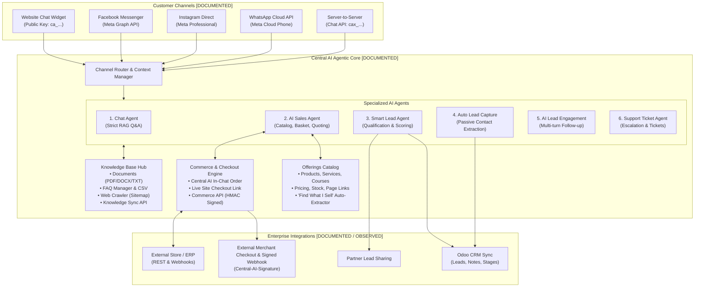

# Central AI Audit: Executive Summary

- **Product Name**: Central AI
- **Application URL**: `https://centralai.daffodil-bd.com`
- **Vendor / Operator**: Daffodil Computers Ltd / Daffodil Family [DOCUMENTED]
- **Headquarters**: 64/3, Lake Circus, 2nd floor, Mirpur Rd, Dhaka 1205, Bangladesh [DOCUMENTED]
- **Target Geographies**: Bangladesh, India, UAE, USA, UK, Malaysia [DOCUMENTED]
- **Audit Date**: October 2026
- **Status of Audit**: Active / Complete Documentation Pass

---

## 1. High-Level Product Overview

Central AI is an enterprise conversational AI platform that unites **autonomous AI agents**, **omnichannel social and web communication**, **Odoo CRM integration**, and **conversational commerce** into a single software-as-a-service (SaaS) suite.

Unlike basic informational chatbots that only perform single-turn retrieval-augmented generation (RAG) over uploaded FAQs, Central AI divides conversational responsibilities into **6 specialized AI agents**:
1. **Chat Agent** (Knowledge Base Q&A & Hallucination-free Retrieval)
2. **AI Sales Agent** (Catalog Navigation, Basket Building & Order Taking)
3. **Smart Lead Agent** (Daily Batch Conversation Summarization & Categorization)
4. **Auto Lead Capture** (Passive Contact Data Extraction)
5. **AI Lead Engagement** (Automated Mailbox Email Follow-ups)
6. **Support Ticket Agent** (Issue Classification & Escalation)

In addition to web-based chat widgets, Central AI integrates natively with Meta messaging channels (**Facebook Messenger, Instagram Direct, WhatsApp Cloud API**). It features a dedicated **Commerce & Live Checkout Engine** designed specifically for South Asian and global transactional commerce, redirecting buyers to the merchant's external website cart ({items}, {ref}) and listening for HMAC-signed order webhooks (Central-AI-Signature).

---

## 2. High-Level Architectural Diagram

---

## 3. Commercial Packaging & Pricing Tiers

Central AI operates on a multi-tier SaaS model with strict credit quotas and feature gating [DOCUMENTED]:

| Tier | Price | Chat Messages / Mo | Knowledge Records | Dashboard Seats | Key Features & Access |
| :--- | :--- | :--- | :--- | :--- | :--- |
| **Test Drive** | Free (7 Days) | 60 | 300 | 1 | Web widget, basic FAQ/Docs, playground. Social & CRM disabled. [OBSERVED] |
| **Starter** | $15 / mo (~1,800 BDT) | 3,000 | 3,000 | 4 | Web widget, Facebook Messenger, Web training. |
| **Growth** | $50 / mo (~6,200 BDT) | 15,000 | 10,000 | 10 | WhatsApp, Instagram, Smart Lead Agent (3k credits), Odoo CRM, 1 Partner. |
| **Scale** | $150 / mo (~18,600 BDT)| 50,000 | 50,000 | 20 | All Growth features + 9k lead credits, 5 Partners, White-label branding. |
| **Custom** | Tailored | Unlimited / Pooled | Dedicated Quota | Custom | Custom integrations, SLA, on-premise or private cloud options. |

---

## 4. Key Strategic Differentiators vs. `multi-source-chatbot`

| Evaluation Criteria | Central AI Platform | Our System (`multi-source-chatbot`) |
| :--- | :--- | :--- |
| **Primary Focus** | Conversational sales, lead qualification, social channel outreach, and order capture. | Enterprise deep document search, unstructured knowledge retrieval, and tabular analytics. |
| **Data Analytics on Tables** | Flattens CSVs into key-value text pairs (`Col: Val`). Cannot execute mathematical SQL queries. [DOCUMENTED] | **Deterministic Analytics Engine**: SQLite per file, automated join discovery, SQL synthesis, accurate math. [OBSERVED] |
| **Search Engine Infrastructure** | Document chunking (~400 chars, 80 overlap), vector similarity. [DOCUMENTED] | **Typesense Hybrid Search**: Dense vector + sparse BM25 retrieval, document_type scoping, workspace filtering. [OBSERVED] |
| **E-Commerce & Transactions** | **Full conversational commerce**: Native cart/basket, confirmation codes, decoupled Live Checkout link ({items}, {ref}), signed order webhooks (Central-AI-Signature), HMAC Commerce API. [DOCUMENTED] | None (currently restricted to informational RAG and analytical queries). [OBSERVED] |
| **Omnichannel Messaging** | Native Meta Cloud integration: Facebook Messenger, Instagram Direct, WhatsApp Cloud API. [DOCUMENTED] | Web embed widget & internal testing playground only. [OBSERVED] |
| **CRM Integration** | **Native Odoo CRM pipeline synchronization** with auto lead stages and partner sharing. [DOCUMENTED] | Generic webhook endpoints and database records. [OBSERVED] |
| **Security Architecture** | Two-tier key scheme (`ca_...` public widget, `cax_...` secret server API), Origin whitelisting. [DOCUMENTED] | Granular Spatie RBAC (`faq.view`, `knowledge_document.view`, Superadmin workspace switching). [OBSERVED] |

---

## 5. Audit Evidence Summary

- **Total Documentation Files Written**: 33 markdown files in `docs/product-audit/central-ai/`.
- **Total Functional Modules Identified**: 25 modules (`MOD-01` to `MOD-25`) baselined in `16_FINAL_CAPABILITY_BASELINE.md`.
- **Live Authenticated Routes Inspected**: 54 platform endpoints crawled (`scratch/live_inspected_screens.json`).
- **Live Detailed Screen Catalogs**: 16 screens cataloged in `03_DASHBOARD_SCREEN_CATALOG.md`.
- **Official Documentation Chapters Analyzed**: 17 complete documentation topics (`/docs/`).
- **Server API Specification Tables Extracted**: 19 reference tables from `/chat/api/docs/`.
- **Comparative SaaS Framework**: Neutral comparison matrix provided in `17_FEATURE_COMPARISON_TEMPLATE.md`.
- **Normalized Evidence Standard Applied**:
  - `[OBSERVED_LIVE]`: Directly inspected in the live authenticated web application UI.
  - `[TESTED_LIVE]`: Operation or client component actively tested (e.g. CSRF login handshake, playground token streaming).
  - `[DOCUMENTED]`: Explicitly confirmed in official documentation or in-app API tables.
  - `[GATED_PLAN]`: Route redirected to `/accounts/pricing/` due to plan restrictions on the Test Drive tier.
  - `[UNTESTED_BEHAVIOR]`: Documented interface or workflow whose live runtime side-effects were not executed to preserve safety.
  - `[INFERRED]`: Reasonable interpretation supported by evidence but not directly proven.
  - `[CONFLICTING_EVIDENCE]`: Prior audit claims or internal sources disagreed and were reconciled.
  - `[UNVERIFIED]`: Proprietary vendor implementation (e.g. internal vector DB engine) undisclosed in evidence.
