# Central AI: Product & Verified Navigation Map

- **Target System**: Central AI (`https://centralai.daffodil-bd.com`)
- **Inspection Date**: October 2026 (Live Authenticated Crawl Pass)
- **Account Identity**: Authenticated Workspace (`zesan`, Company: `ABC`)
- **Audit Methodology**: Live authenticated DOM inspection across 54 discovered platform routes [OBSERVED_LIVE] cross-verified with official documentation [DOCUMENTED].

---

## 1. Global Navigation Hierarchy

The Central AI web console is structured into 7 core functional zones accessible from the persistent sidebar and top navigation:

```mermaid
graph TD
    ROOT["Central AI Platform Console"]

    subgraph NavigationZones ["Verified Functional Zones"]
        ZONE_AI["1. AI Agent Core & Playground"]
        ZONE_KB["2. Knowledge Hub & Documents"]
        ZONE_COMM["3. AI Sales & Offerings Catalog"]
        ZONE_LEADS["4. Lead Capture & CRM Pipelines"]
        ZONE_SUPPORT["5. Support Tickets & Helpdesk"]
        ZONE_CHANNELS["6. Channels & Public Embed"]
        ZONE_ACCOUNTS["7. Company, Team & Security Settings"]
    end

    ROOT --> ZONE_AI
    ROOT --> ZONE_KB
    ROOT --> ZONE_COMM
    ROOT --> ZONE_LEADS
    ROOT --> ZONE_SUPPORT
    ROOT --> ZONE_CHANNELS
    ROOT --> ZONE_ACCOUNTS

    ZONE_AI --> AI_DASH["Dashboard Overview (/chat/dashboard/)"]
    ZONE_AI --> AI_PLAY["Interactive Playground (/chat/chatbot/)"]
    ZONE_AI --> AI_SETUP["Agents & Tools Settings (/chat/chatbot/settings/)"]
    ZONE_AI --> AI_GUIDE["Chatbot Prompt Guidelines (/chat/chatbot/guidelines/)"]

    ZONE_KB --> KB_HOME["Knowledge Base (/knowledge/)"]
    ZONE_KB --> KB_UPLOAD["Upload Document (/knowledge/upload/)"]
    ZONE_KB --> KB_FAQS["Knowledge Management / FAQs (/chat/faqs/)"]
    ZONE_KB --> KB_FAQ_ADD["Add FAQ (/chat/faqs/add/)"]
    ZONE_KB --> KB_EXPORT["Export Knowledge (/knowledge/export/)"]
    ZONE_KB --> KB_WEB["Web Training Crawler (/knowledge/web-training/ - Gated)"]

    ZONE_COMM --> COMM_SETUP["AI Sales Agent Setup (/sales/)"]
    ZONE_COMM --> COMM_OFFERINGS["Offerings Catalog (/sales/offerings/)"]
    ZONE_COMM --> COMM_OFFERING_NEW["New Offering Form (/sales/offerings/new/)"]
    ZONE_COMM --> COMM_OFFERING_IMP["Import Offerings CSV (/sales/offerings/import/)"]
    ZONE_COMM --> COMM_SUGG["Suggestions Queue / Find What I Sell (/sales/suggestions/)"]

    ZONE_LEADS --> LEADS_CAPTURE["Auto Lead Capture Dashboard (/lead-capture/dashboard/)"]
    ZONE_LEADS --> LEADS_ENGAGE["AI Lead Engagement Settings (/lead-engagement/settings/)"]
    ZONE_LEADS --> LEADS_LIST["Leads List (/leads/ - Gated on Test Drive)"]
    ZONE_LEADS --> LEADS_INTEG["Lead Integrations / Odoo Sync (/leads/integrations/)"]
    ZONE_LEADS --> LEADS_CONV["Conversions Upload (/leads/conversions/upload/ - Gated)"]

    ZONE_SUPPORT --> SUPP_INBOX["Support Tickets Inbox (/support/tickets/)"]
    ZONE_SUPPORT --> SUPP_CREATE["Create Support Ticket (/support/tickets/create/)"]

    ZONE_CHANNELS --> CHAN_WIDGET["Website Chat Widget (/chat/widget/)"]
    ZONE_CHANNELS --> CHAN_META["Social Channels Meta Hub (/integrations/meta/)"]
    ZONE_CHANNELS --> CHAN_LOGS["Chat Logs & Transcripts (/chat/chat-logs/)"]

    ZONE_ACCOUNTS --> ACC_CO["Update Company (/accounts/company/update/)"]
    ZONE_ACCOUNTS --> ACC_MAIL["Mailboxes Management (/accounts/company/mailboxes/)"]
    ZONE_ACCOUNTS --> ACC_TEAM["Team Management (/accounts/team/)"]
    ZONE_ACCOUNTS --> ACC_KEYS["API Keys (/accounts/security/api-keys/)"]
    ZONE_ACCOUNTS --> ACC_NOTIF["Notifications (/accounts/notifications/)"]
    ZONE_ACCOUNTS --> ACC_FEED["Submit Feedback (/accounts/feedback/)"]
    ZONE_ACCOUNTS --> ACC_USAGE["Usage Dashboard (/billing/usage/)"]
    ZONE_ACCOUNTS --> ACC_INV["Invoices (/billing/invoices/)"]
    ZONE_ACCOUNTS --> ACC_API_DOCS["In-App API Reference (/chat/api/docs/)"]
```

---

## 2. Exhaustive Route Map & Access Gating Matrix

| Route Path | Screen Title | Functional Zone | Observed HTTP Status | Plan Access Gating |
| :--- | :--- | :--- | :---: | :--- |
| `/chat/dashboard/` | Dashboard | 1. Agent Core | 200 OK | All Plans [OBSERVED_LIVE] |
| `/chat/chatbot/` | Playground - Central AI | 1. Agent Core | 200 OK | All Plans [OBSERVED_LIVE] |
| `/chat/chatbot/settings/` | Agents & Tools - Central AI | 1. Agent Core | 200 OK | All Plans [OBSERVED_LIVE] |
| `/chat/chatbot/guidelines/` | Chatbot Prompt Guidelines | 1. Agent Core | 200 OK | All Plans [OBSERVED_LIVE] |
| `/knowledge/` | Knowledge Base | 2. Knowledge Hub | 200 OK | All Plans [OBSERVED_LIVE] |
| `/knowledge/upload/` | Upload Document - Central AI | 2. Knowledge Hub | 200 OK | All Plans [OBSERVED_LIVE] |
| `/knowledge/export/` | Export Knowledge | 2. Knowledge Hub | 200 OK | All Plans [OBSERVED_LIVE] |
| `/knowledge/docs/` | Documentation Hub - Central AI | 2. Knowledge Hub | 200 OK | All Plans [OBSERVED_LIVE] |
| `/chat/faqs/` | Knowledge Management | 2. Knowledge Hub | 200 OK | All Plans [OBSERVED_LIVE] |
| `/chat/faqs/add/` | Add FAQ | 2. Knowledge Hub | 200 OK | All Plans [OBSERVED_LIVE] |
| `/knowledge/web-training/`| Pricing - Central AI | 2. Knowledge Hub | 302 -> /accounts/pricing/ | **Gated: Starter+** [OBSERVED_LIVE] |
| `/sales/` | AI Sales Agent \| Central AI | 3. Offerings & Commerce | 200 OK | All Plans [OBSERVED_LIVE] |
| `/sales/offerings/` | Offerings \| AI Sales Agent | 3. Offerings & Commerce | 200 OK | All Plans [OBSERVED_LIVE] |
| `/sales/offerings/new/` | New offering \| AI Sales Agent | 3. Offerings & Commerce | 200 OK | All Plans [OBSERVED_LIVE] |
| `/sales/offerings/import/` | Import offerings \| AI Sales Agent | 3. Offerings & Commerce | 200 OK | All Plans [OBSERVED_LIVE] |
| `/sales/suggestions/` | Needs your review \| AI Sales Agent | 3. Offerings & Commerce | 200 OK | All Plans [OBSERVED_LIVE] |
| `/lead-capture/dashboard/`| Auto Lead Capture \| ABC | 4. Leads & CRM | 200 OK | All Plans [OBSERVED_LIVE] |
| `/lead-engagement/settings/`| AI Lead Engagement Agent | 4. Leads & CRM | 200 OK | All Plans [OBSERVED_LIVE] |
| `/leads/` | Pricing - Central AI | 4. Leads & CRM | 302 -> /accounts/pricing/ | **Gated: Starter+** [OBSERVED_LIVE] |
| `/leads/integrations/` | Lead integrations \| Central AI | 4. Leads & CRM | 200 OK | All Plans [OBSERVED_LIVE] |
| `/leads/conversions/upload/`| Pricing - Central AI | 4. Leads & CRM | 302 -> /accounts/pricing/ | **Gated: Growth+** [OBSERVED_LIVE] |
| `/leads/email-settings/` | Pricing - Central AI | 4. Leads & CRM | 302 -> /accounts/pricing/ | **Gated: Growth+** [OBSERVED_LIVE] |
| `/support/tickets/` | Support Tickets | 5. Support Desk | 200 OK | All Plans [OBSERVED_LIVE] |
| `/support/tickets/create/` | Create Support Ticket | 5. Support Desk | 200 OK | All Plans [OBSERVED_LIVE] |
| `/chat/widget/` | Widget Integration \| ABC | 6. Channels & Embed | 200 OK | All Plans [OBSERVED_LIVE] |
| `/integrations/meta/` | Social Channels - Central AI | 6. Channels & Embed | 200 OK | All Plans [OBSERVED_LIVE] |
| `/chat/chat-logs/` | Chat Logs - Central AI | 6. Channels & Embed | 200 OK | All Plans [OBSERVED_LIVE] |
| `/accounts/company/update/`| Update Company \| Central AI | 7. Account & System | 200 OK | All Plans [OBSERVED_LIVE] |
| `/accounts/company/mailboxes/`| Mailboxes \| Central AI | 7. Account & System | 200 OK | All Plans [OBSERVED_LIVE] |
| `/accounts/team/` | Team Management | 7. Account & System | 200 OK | All Plans [OBSERVED_LIVE] |
| `/accounts/security/api-keys/`| API Keys - Central AI | 7. Account & System | 200 OK | All Plans [OBSERVED_LIVE] |
| `/accounts/notifications/`| Notifications \| Central AI | 7. Account & System | 200 OK | All Plans [OBSERVED_LIVE] |
| `/accounts/feedback/` | Submit Feedback - Central AI | 7. Account & System | 200 OK | All Plans [OBSERVED_LIVE] |
| `/billing/usage/` | Usage Dashboard | 7. Account & System | 200 OK | All Plans [OBSERVED_LIVE] |
| `/billing/invoices/` | Invoices - Central AI | 7. Account & System | 200 OK | All Plans [OBSERVED_LIVE] |
| `/chat/api/docs/` | API Reference - Central AI | 7. Account & System | 200 OK | All Plans [OBSERVED_LIVE] |

---

## 3. Discovered Legacy / Inactive Paths (Corrected 404s)
- **`/security/`**: Returns HTTP 404. Real security route is `/accounts/security/api-keys/` [OBSERVED_LIVE].
- **`/accounts/mailboxes/`**: Returns HTTP 404. Real mailboxes route is `/accounts/company/mailboxes/` [OBSERVED_LIVE].
- **`/knowledge/api/docs/`**: Redirects to `/accounts/pricing/`. Real API documentation hub is at `/chat/api/docs/` [OBSERVED_LIVE].
