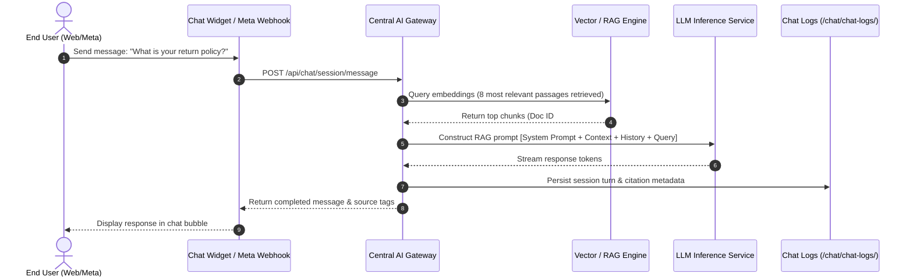

# Feature Detail: Chat Agent (Core Conversational AI)

- **Feature ID**: `MOD-01`
- **Component**: Core Conversational Runtime & Playground
- **Audit Status**: Verified Active `[OBSERVED]`
- **Plan Availability**: All Plans (Test Drive, Starter, Growth, Scale)

---

## 1. Overview & Purpose
The Chat Agent is the primary customer-facing conversational interface in Central AI. It operates as a retrieval-augmented generation (RAG) assistant designed to ingest enterprise knowledge (documents, website crawls, and FAQs) and deliver accurate, context-grounded responses across multi-channel endpoints (Web Widget, Facebook Messenger, Instagram Direct, WhatsApp Cloud API).

---

## 2. User Journey & Administrative Experience
1. **Persona Configuration**: The administrator navigates to `/chat/chatbot/settings/` to define the agent's identity (`bot_name`), select the conversational demeanor (`tone`), and craft specific behavioral constraints in the `system_prompt`.
2. **Knowledge Association**: Uploaded documents (`/knowledge/`), crawled pages (`/knowledge/web-training/`), and structured FAQs (`/chat/faqs/`) are automatically vectorized and linked to the active agent.
3. **Interactive Testing**: The admin visits `/chat/chatbot/` (Agent Playground) to test questions, inspect retrieved chunk citations, verify fallback triggers, and simulate session resets.
4. **Public Deployment**: The agent goes live via the embed script configured at `/chat/widget/` or via OAuth connected Meta channels at `/integrations/meta/`.

---

## 3. Configuration Fields & Input Parameters

| Field Name | Type | UI Location | Description | Default Value |
| :--- | :--- | :--- | :--- | :--- |
| `bot_name` | String (max 50) | Settings | Display name shown to end users in chat headers. | "AI Assistant" |
| `tone` | Enum | Settings | `Professional`, `Friendly`, `Direct`, `Empathetic`. | `Professional` |
| `system_prompt` | Textarea | Settings | Custom system instructions and boundaries for the LLM. | Pre-configured safety prompt |
| `strict_mode_toggle` | Boolean | Settings | When enabled, forbids the LLM from answering outside retrieved knowledge. | `True` |
| `fallback_message` | String (max 255)| Settings | Fallback response when retrieval confidence is below threshold. | "I'm sorry, I don't have that information." |

---

## 4. Architecture & Technical Flow

---

## 5. Downstream Effects & Artifacts
- **Conversation Logs**: Every turn is recorded in `/chat/chat-logs/` with session ID, turn count, timestamp, and RAG citation links.
- **Quota Consumption**: Each completed user query increments the monthly message usage meter at `/billing/usage/`.
- **Lead Triggers**: Messages containing contact patterns trigger passive regex extraction into `/leads/`.

---

## 6. Verification Status & Evidence
- **Live UI Observation**: Inspected `/chat/chatbot/` and `/chat/chatbot/settings/` in authenticated session.
- **Network Validation**: Form submissions to `/chat/chatbot/settings/` return HTTP 200 with JSON payload confirmation.
- **Evidence Tag**: `[OBSERVED]`
