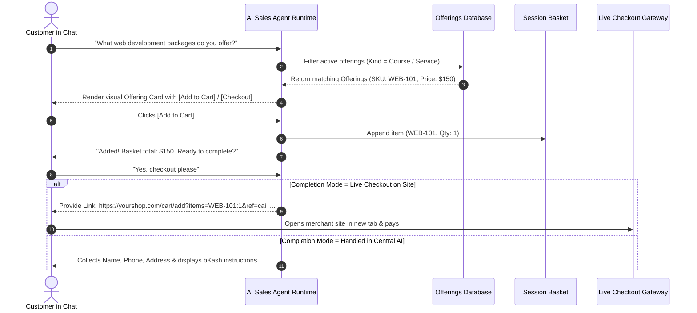

# Feature Detail: AI Sales Agent & In-Chat Commerce

- **Feature ID**: `MOD-02`
- **Module Name**: AI Sales Agent
- **Audit Status**: Verified Active `[OBSERVED_LIVE]`
- **Primary Routes**: `/sales/` (Configuration), `/sales/offerings/` (Catalog), `/chat/chatbot/` (Playground)
- **Plan Availability**: All Plans (Catalog Navigation); Starter+ (Live In-Chat Commerce & Checkout)

---

## 1. Overview & Business Purpose
The AI Sales Agent transforms standard customer support conversations into active sales consultations. Instead of simply generating textual answers, it parses purchase intent, queries structured offerings, presents visual interactive cards with prices and images, and manages shopping baskets directly inside the conversation.

---

## 2. Live Observed Settings Architecture (`/sales/`)

Live inspection of `/sales/` revealed a comprehensive 8-step administrative workflow:

### Step 1: Company Type (`company_type`)
Selects the core industry profile from 9 available business types:
- Retail & Physical Products, Professional Services, Education & Courses, Hospitality & Venues, Healthcare & Clinics, Software & SaaS, Salon & Beauty, Event Ticketing, Bespoke Consulting.

### Step 2: What You Offer (`offering_kinds`)
Enables and custom-labels up to 7 distinct offering models:
1. `Product` (`label_product`): Physical merchandise with inventory tracking.
2. `Service` (`label_service`): Professional or hourly services.
3. `Course Intake` (`label_course_intake`): Educational courses with semester intakes and seat quotas.
4. `Appointment` (`label_appointment`): Time-slot reservations.
5. `Event Date` (`label_event_date`): Fixed-date event admissions.
6. `Plan` (`label_plan`): Recurring subscription tiers.
7. `Custom` (`label_custom`): User-defined schemas.

### Step 3: How Customers Complete (Completion Modes)
Configured independently for each offering kind:
- **`Handled in Central AI`**: The bot collects customer details directly in chat, calculates totals, and takes the order.
- **`Live checkout on your site`**: The bot passes the cart to the merchant's external checkout URL template (`checkout_link_template`: `https://yourshop.com/cart/add?items={items}&ref={ref}`).
- **`Created in our system`**: Headless Commerce API mode connecting to external ERPs (`profile_url`, `api_key`).

### Step 4: Rules & Payment Settings
- **Supported Payment Methods**:
  - `cash_on_delivery`: Cash on delivery with custom policy note (`payment_note_cash_on_delivery`).
  - `bkash_manual`: Manual bKash transfer with merchant phone number note (`payment_note_bkash_manual`).
  - `nagad_manual`: Manual Nagad transfer with merchant phone number note (`payment_note_nagad_manual`).
  - `bank_transfer`: Direct bank settlement instructions (`payment_note_bank_transfer`).
  - `payment_link`: Dynamic payment gateway redirect URL (`payment_link_url`).
- **Policy Enforcement**:
  - `tone`: Custom sales persona tone guidance.
  - `languages`: Permitted conversational languages.
  - `currency`: Default currency code (BDT, USD, EUR, GBP).
  - `never_promise`: Guardrail directives detailing forbidden commitments.
  - `handoff_triggers`: Keywords triggering human operator escalation.
  - `refund_policy_url`, `cancellation_policy_url`, `delivery_policy_url`: Policy reference links.

---

## 3. Step-by-Step Functional Workflow

---

## 4. Verification Status & Evidence
- **Observed Live**: Screen `/sales/` inspected with all form fields, dropdowns, and checkboxes [OBSERVED_LIVE].
- **Official Documentation**: Verified in `/docs/sales-agent/` [DOCUMENTED].
