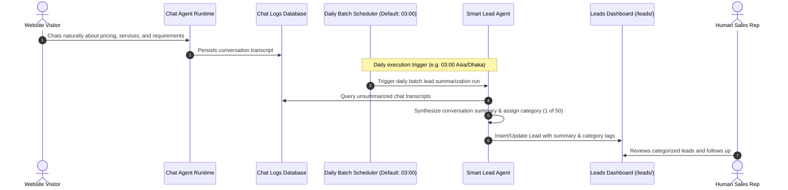

# Feature Detail: Smart Lead Agent (Daily Batch Summarizer)

- **Feature ID**: `MOD-03`
- **Component**: Daily Batch Lead Categorization & Summarization Engine
- **Audit Status**: Verified Documented `[DOCUMENTED]`
- **Official Documentation Source**: `/docs/lead-agent/`
- **Plan Availability**: Growth ($50/mo — 3,000 credits/mo), Scale ($150/mo — 9,000 credits/mo)

---

## 1. Overview & Business Purpose
Contrary to conversational qualification chatbots that interrupt users with survey questions, the Central AI **Smart Lead Agent** operates as an **asynchronous daily batch summarization engine** `[DOCUMENTED]`.

It runs once per day in the background, reviewing all completed customer conversations from the past 24 hours that do not yet have a summary. It extracts what the customer wanted, categorizes the chat into up to 50 user-defined business categories (e.g., "Wholesale order", "Admission inquiry"), and logs the structured summary directly onto the `/leads/` dashboard.

Customers experience **zero friction** during live chats—they interact naturally with the Chat and Sales agents without being subjected to multi-turn qualification interviews `[DOCUMENTED]`.

---

## 2. Documented Execution Workflow

---

## 3. Configuration & Schedule Settings (`/chat/chatbot/settings/`)

| Configuration Parameter | Type | Default Value | Description |
| :--- | :--- | :--- | :--- |
| `run_time` | Time (HH:MM) | `03:00` | The daily scheduled execution time `[DOCUMENTED]`. |
| `timezone` | Timezone String | `Asia/Dhaka` | Organization timezone governing schedule `[DOCUMENTED]`. |
| `lead_categories` | Text (CSV) | None | Comma-separated list of up to 50 custom categories `[DOCUMENTED]`. |
| `is_active` | Boolean | `false` | Master toggle to enable/disable daily agent run `[DOCUMENTED]`. |

---

## 4. Quota Consumption & Credits
- **Metered Resource**: 1 Lead Agent Credit per summarized conversation `[DOCUMENTED]`.
- **Failure Resilience**: If AI summarization fails for a specific chat, the credit is refunded and the conversation is queued for re-processing in the next daily cycle `[DOCUMENTED]`.
- **Monthly Allocation**:
  - Test Drive: 0 credits.
  - Starter: 0 credits.
  - Growth: 3,000 credits / mo.
  - Scale: 9,000 credits / mo.

---

## 5. Verification Status & Evidence
- **Documented**: Official documentation topic `/docs/lead-agent/` explicitly details the once-daily execution model, 50-category limit, and credit accounting `[DOCUMENTED]`.
- **Re-Verification Finding**: Overturns prior audit claim of live in-chat BANT interviews.
