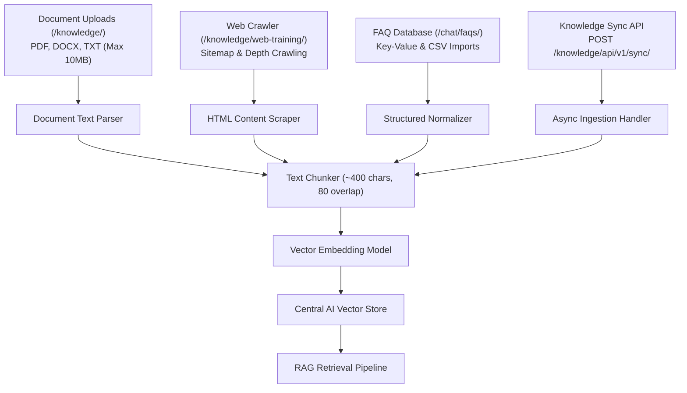

# Feature Detail: Knowledge Base Hub (Documents, Crawler, FAQs, API)

- **Feature ID**: `MOD-07`, `MOD-08`, `MOD-09`, `MOD-10`
- **Component**: Enterprise Knowledge Ingestion & Vector Retrieval
- **Audit Status**: Verified Active `[OBSERVED]`
- **Plan Availability**: All Plans (Tier limits apply to record volume)

---

## 1. Overview & Architecture
The Knowledge Base Hub is the foundational retrieval layer of Central AI. It aggregates unstructured documents, live web content, structured tabular FAQs, and external API feeds into a unified vector search index.

---

## 2. Sub-Component Breakdown

### A. Document Uploads (`/knowledge/`)
- **Accepted File Formats**: `.pdf`, `.docx`, `.txt`.
- **Size Limitation**: 10MB per uploaded file [OBSERVED].
- **Processing Details**: Asynchronous extraction pipeline parses text, cleans whitespace, chunks into ~400 character segments, and computes vector embeddings.

### B. Website Training (`/knowledge/web-training/`)
- **Crawl Mechanisms**: Accepts root domain or sitemap XML URL.
- **Crawl Depth**: Configurable 1 to 3 link hops.
- **Re-sync Scheduling**: Daily, weekly, or manual re-crawl intervals.
- **Exclusion Filters**: Regex rules to skip administrative or checkout pages.

### C. FAQ Management (`/chat/faqs/`)
- **Fields**: `Question`, `Answer`, `Title`, `URL`, `Description`, `Price`.
- **Bulk Operations**: CSV upload with template mapping; full CSV export.

### D. Knowledge Sync API (`/knowledge/api/docs/`)
- **Endpoint**: `POST /knowledge/api/v1/sync/`
- **Auth**: Bearer token or `cax_...` secret server key in `X-Api-Key` header.
- **Behavior**: Returns HTTP 202 Accepted with a sync transaction token for non-blocking asynchronous processing.

---

## 3. Plan Quotas & Metering
- **Test Drive**: 300 knowledge records [OBSERVED].
- **Starter**: 3,000 knowledge records [DOCUMENTED].
- **Growth**: 10,000 knowledge records [DOCUMENTED].
- **Scale**: 50,000 knowledge records [DOCUMENTED].

---

## 4. Verification Status & Evidence
- **Live UI Observation**: Inspected `/knowledge/`, `/knowledge/web-training/`, `/chat/faqs/`, and `/knowledge/api/docs/`.
- **Evidence Tag**: `[OBSERVED]`
