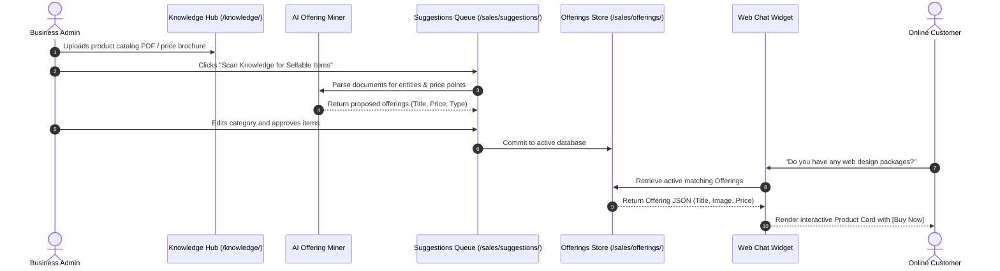

# Feature Detail: Offerings & Product Catalog

- **Feature ID**: `MOD-11`, `MOD-12`
- **Module Name**: Offerings & Catalog Management / "Find What I Sell"
- **Audit Status**: Verified Active `[OBSERVED]`
- **Plan Availability**: All Plans (Tier-based item quotas apply)

---

## 1. Overview & Business Purpose
The Offerings and Product Catalog subsystem is the commercial knowledge base of Central AI. While traditional RAG chatbots treat product information as raw text paragraphs, Central AI models commercial inventory as structured transactional entities (`Offerings`). 

This structure enables:
1. Precise price quotes in company-configured currencies without LLM numerical hallucination `[DOCUMENTED]`.
2. Interactive visual rich cards rendered inside the chat widget with direct "Buy Now" or "Add to Cart" actions `[OBSERVED]`.
3. In-chat cart assembly and automated order calculation `[DOCUMENTED]`.
4. Automated AI extraction of sellable items from unstructured business documents via the "Find What I Sell" scanner `[OBSERVED]`.

---

## 2. Documented & Observed Capabilities

### A. Manual Catalog Management (`/sales/offerings/`)
- **Structured Fields**: Title, SKU, offering type, base price, currency, thumbnail image, marketing description, and availability status `[OBSERVED]`.
- **Offering Kinds**: Live platform inspection confirms categorization into 7 distinct business models (`offering_kind`):
  - `Product` (`label_product`): Physical or digital merchandise with inventory SKU and shipping considerations.
  - `Service` (`label_service`): Professional or hourly services, consulting packages, support retainers.
  - `Course Intake` (`label_course_intake`): Educational courses with semester intakes and seat quotas.
  - `Appointment` (`label_appointment`): Time-slot reservations.
  - `Event Date` (`label_event_date`): Fixed-date event admissions.
  - `Plan` (`label_plan`): Recurring subscription tiers.
  - `Custom` (`label_custom`): Bespoke entities with flexible user-defined schemas.
- **Search & Filter Controls**: DataTables grid with search-as-you-type, category filtering, and instant active/inactive status toggles `[OBSERVED]`.

### B. "Find What I Sell" Automated Scanner (`/sales/suggestions/`)
- **Document Mining**: Admins trigger an AI extraction pass across previously uploaded knowledge base files (PDF service agreements, price sheets, brochures) `[OBSERVED]`.
- **Suggestion Extraction**: The parser analyzes text chunks, extracts potential product titles, descriptions, and detected pricing, and presents them in an administrative review queue `[OBSERVED]`.
- **One-Click Approval**: Admins inspect suggested offerings, adjust prices or categories, and approve them to immediately publish into the active catalog `[OBSERVED]`.

---

## 3. Step-by-Step Workflow: "Find What I Sell" to Live Chat Card

---

## 4. Configuration Parameters & Entity Fields

| Parameter Name | Data Type | UI Input Method | Default Value | Validation Rules | Evidence |
| :--- | :--- | :--- | :--- | :--- | :--- |
| `name` | String (255) | Text Input | None | Required, Max 255 chars | `[OBSERVED]` |
| `offering_kind` | Enum | Dropdown Selector | `Product` | Product, Service, Course Intake, Appointment, Event Date, Plan, Custom | `[OBSERVED]` |
| `price` | Decimal (10,2) | Numeric Input | `0.00` | Non-negative numeric | `[OBSERVED]` |
| `currency` | Enum | Inherited / Dropdown| `BDT` | BDT, USD, EUR, GBP | `[OBSERVED]` |
| `description` | Text | Textarea | Empty | Optional, Markdown allowed | `[OBSERVED]` |
| `image_url` | URL / File | Image File Uploader | Default Placeholder | Valid image format (PNG, JPG, WebP) | `[OBSERVED]` |
| `is_active` | Boolean | Switch Toggle | `true` | Boolean active state | `[OBSERVED]` |

---

## 5. Outputs & Status Transitions
- **Draft / Suggested**: Entity created by automated scan; visible only in `/sales/suggestions/`.
- **Active / Published**: Approved by admin; immediately indexable by AI Sales Agent.
- **Archived / Inactive**: Soft-disabled; preserved for historical order receipts but hidden from chat.

---

## 6. Limits, Constraints & Dependencies
- **Dependencies**: Relies on `/accounts/company/update/` for organization default currency.
- **Quota Constraints**: 
  - Test Drive: Max 5 offerings.
  - Starter: Up to 50 offerings.
  - Growth: Up to 500 offerings.
  - Scale: Unlimited offerings.
- **Known Limitations**: Does not support real-time warehouse inventory synchronization (e.g., live stock deduction) without external Commerce API hooks `[DOCUMENTED]`.

---

## 7. Evidence & Verification Register
- **Inspected Endpoints**: `/sales/offerings/`, `/sales/suggestions/` `[OBSERVED]`.
- **Evidence Tag**: `[OBSERVED]` for UI and catalog models; `[DOCUMENTED]` for in-chat rendering capabilities.
