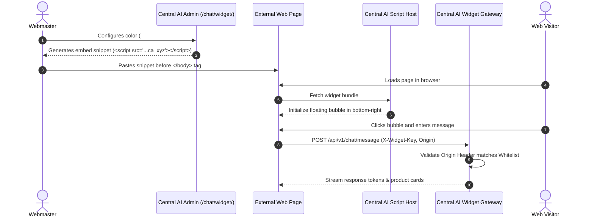

# Feature Detail: Website Chat Widget

- **Feature ID**: `MOD-13`
- **Module Name**: Embeddable Web Chat Widget
- **Audit Status**: Verified Active `[OBSERVED]`
- **Plan Availability**: All Plans (Test Drive, Starter, Growth, Scale)

---

## 1. Overview & Business Purpose
The Website Chat Widget is the primary customer-facing entry point for web visitors. It is an embeddable, lightweight JavaScript snippet that instantiates a floating chat bubble and modal dialogue on any website, providing 24/7 conversational support, lead capture, and interactive shopping.

---

## 2. Documented & Observed Capabilities

### A. Embed Architecture (`/chat/widget/`)
- **One-Line Script Tag**: Implemented as an asynchronous script loading an isolated web component or iframe `[OBSERVED]`.
- **Public API Key**: Authentication relies on a tenant-specific public widget key (`ca_...`) `[OBSERVED]`.
- **Origin Whitelisting**: Mandatory security feature where admins must register permitted domain hostnames (e.g., `example.com`, `shop.example.com`). Embedded scripts on unapproved origins are blocked by CORS/server validation `[OBSERVED]`.

### B. Styling & Visual Customization
- **Primary Color Selector**: Hex color picker configuring the widget header, floating button, and user message bubbles `[OBSERVED]`.
- **Avatar & Branding**: Upload custom agent avatar logo or organization icon `[OBSERVED]`.
- **Header Title & Subtitle**: Customizable greeting labels (e.g., *"Customer Support"*, *"We reply instantly"*).
- **Placement Toggle**: Screen docking option for **Bottom-Right** or **Bottom-Left** `[OBSERVED]`.
- **Initial Welcome Message**: Greeting proactively displayed when the widget expands `[OBSERVED]`.

### C. Client-Side Runtime Behavior
- **Session Continuity**: Retains visitor conversation history across page navigation using browser `localStorage` or `sessionStorage` `[OBSERVED]`.
- **Streaming Responses**: Real-time server-sent events (SSE) token streaming for responsive typing feel `[DOCUMENTED]`.
- **Interactive Component Rendering**: Renders rich interactive cards (product items, lead capture buttons, rating stars) directly inside the dialogue `[DOCUMENTED]`.

---

## 3. Step-by-Step Deployment & Execution Flow

---

## 4. Configuration Fields & Settings

| Field | Type | Control | Description | Verification |
| :--- | :--- | :--- | :--- | :--- |
| `widget_public_key` | String (`ca_...`)| Read-only text | Public identifier for the widget | `[OBSERVED]` |
| `allowed_domains` | Text (Multi-line)| Textarea | Whitelisted domains (one per line) | `[OBSERVED]` |
| `theme_color` | Hex Color | Color Picker | Primary UI color token (default `#10B981`) | `[OBSERVED]` |
| `position` | Enum | Radio Buttons | `bottom-right` or `bottom-left` | `[OBSERVED]` |
| `greeting_title` | String | Text Input | Chat window title | `[OBSERVED]` |
| `welcome_message` | Text | Textarea | Initial automated message bubble | `[OBSERVED]` |
| `bot_avatar` | Image File | File Upload | Avatar displayed on widget header | `[OBSERVED]` |

---

## 5. Security & Isolation Controls
- **Origin Header Verification**: Prevents token theft by ensuring requests originate strictly from registered client domains `[OBSERVED]`.
- **Rate Limiting**: Protects against message spam and automated denial-of-service attempts `[DOCUMENTED]`.
- **Public/Private Key Separation**: The widget key (`ca_...`) has read/chat privileges only; administrative and syncing capabilities strictly require secret server keys (`cax_...`) `[DOCUMENTED]`.

---

## 6. Verification Status & Evidence
- **Observed**: Screen `/chat/widget/` fully inspected in authenticated session `[OBSERVED]`.
- **Evidence Tag**: `[OBSERVED]` for all configuration fields; `[DOCUMENTED]` for SSE streaming protocol.
