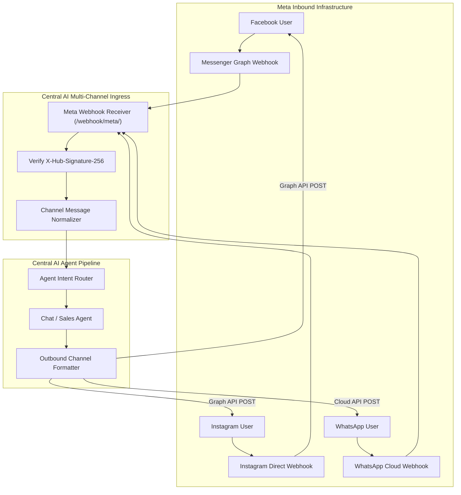

# Feature Detail: Social Channels (Meta Hub)

- **Feature ID**: `MOD-14`
- **Module Name**: Meta Social Hub (Facebook, Instagram, WhatsApp)
- **Audit Status**: Verified Active `[OBSERVED]`
- **Plan Availability**: Starter (Facebook Messenger); Growth & Scale (Instagram, WhatsApp)

---

## 1. Overview & Business Purpose
Central AI unifies inbound communication across Meta's primary consumer messaging platforms into the same core autonomous agent runtime. Instead of maintaining siloed bots or requiring separate conversational engines for each channel, customer interactions from **Facebook Messenger**, **Instagram Direct**, and **WhatsApp Cloud API** are routed to the central RAG knowledge base, sales catalog, and lead capture pipelines.

---

## 2. Channel Breakdown & Supported Features

### A. Facebook Messenger (`/integrations/meta/`)
- **Connection Mechanism**: Meta OAuth login flow linking verified Facebook Pages `[OBSERVED]`.
- **Webhook Handlers**: Subscribes to `messages`, `messaging_postbacks`, and `message_deliveries` `[DOCUMENTED]`.
- **Plan Gating**: Available from Starter plan ($15/mo) `[DOCUMENTED]`.
- **Capabilities**: Full text Q&A, structured quick replies, and lead capture forms.

### B. Instagram Direct (`/integrations/meta/`)
- **Connection Mechanism**: Connects through Facebook Page linked to an Instagram Professional/Business account `[OBSERVED]`.
- **Webhook Handlers**: Listens to Instagram DM webhooks for incoming text and story replies `[DOCUMENTED]`.
- **Plan Gating**: Available on Growth ($50/mo) and Scale ($150/mo) plans `[DOCUMENTED]`.
- **Capabilities**: Resolves product inquiries from Instagram ads, bio links, and direct direct messages.

### C. WhatsApp Cloud API (`/integrations/meta/`)
- **Connection Mechanism**: Official Meta Cloud API integration requiring:
  - Meta Business Account (WABA ID)
  - Phone Number ID
  - Permanent System User Access Token
- **Plan Gating**: Available on Growth and Scale plans `[DOCUMENTED]`.
- **Capabilities**: Automated customer service, in-chat order confirmations, and outbound proactive template messaging (governed by Meta's 24-hour service window rules).

---

## 3. Architecture & Channel Routing Pipeline

---

## 4. Configuration Inputs & Fields

| Channel | Key Input Fields | Source / Credentials | Plan Requirement |
| :--- | :--- | :--- | :--- |
| **Facebook** | `Page ID`, `Page Access Token`, `Verify Token` | Meta App / OAuth Login | Starter+ |
| **Instagram** | `Instagram Account ID`, `Linked Page ID` | Meta Business Suite | Growth+ |
| **WhatsApp** | `WABA ID`, `Phone Number ID`, `Permanent Token` | Meta Developer Portal | Growth+ |

---

## 5. Compliance & Policy Constraints
- **Meta 24-Hour Rule**: Automated replies must occur within 24 hours of customer contact. Outbound messages beyond 24 hours require approved Meta Message Templates `[DOCUMENTED]`.
- **Template Fees**: Proactive WhatsApp template messages incur Meta per-conversation charges billed separately from Central AI subscription quotas `[DOCUMENTED]`.

---

## 6. Verification Status & Evidence
- **Observed**: Screen `/integrations/meta/` inspected directly with Facebook, Instagram, and WhatsApp setup cards `[OBSERVED]`.
- **Documented**: Official documentation confirms Meta Graph API requirements and subscription tier gating `[DOCUMENTED]`.
