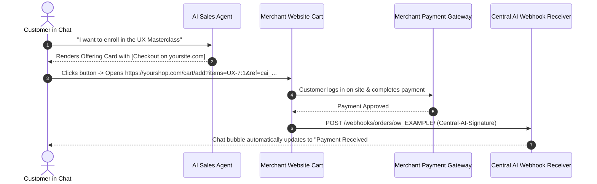

# Feature Detail: Commerce & Live Checkout Architecture

- **Feature ID**: `MOD-15`, `MOD-16`
- **Module Name**: Live Website Checkout & Commerce API (v1.3)
- **Audit Status**: Verified Documented `[DOCUMENTED]`
- **Official Documentation Sources**: `/docs/live-checkout/` and `/docs/commerce-api/`
- **Plan Availability**: Live Checkout (Starter+); Commerce API (Scale, Custom)

---

## 1. Overview & Business Purpose
Central AI's commerce framework connects conversational basket building with external transaction execution. Crucially, Central AI **does not store credit card numbers or process domestic MFS payments directly inside the chat engine**.

Instead, it offers two decoupled integration models:
1. **Live Checkout on Your Site**: The AI Sales Agent builds a basket in chat, then passes the shopper and cart reference to the merchant's *own website checkout page* via URL parameters. The merchant's site processes payment and updates Central AI via an HMAC-signed webhook.
2. **Headless Commerce API (Contract v1.3)**: For custom ERPs or course portals, the *merchant's server implements the API* (quote.calculate, commit.create, commit.lookup) and Central AI invokes it during the chat conversation.

---

## 2. Live Checkout URL Architecture

### The Checkout Link Template
In `/chat/chatbot/settings/`, the merchant configures a parameterized checkout URL:
```text
https://yourshop.com/cart/add?items={items}&ref={ref}
```
- `{items}`: Populated with offering codes and quantities (e.g., `WEB-101:1,UX-7:2`).
- `{ref}`: Unique Central AI chat session tracking token (e.g., `cai_Z3xH1...`).

### The Customer Journey


---

## 3. Order Webhook Specification (`/webhooks/orders/ow_.../`)

- **Method**: `POST`
- **Endpoint**: `http://centralai.daffodil-bd.com/webhooks/orders/ow_MERCHANT_KEY/`
- **Authentication**: `Central-AI-Signature: t=1791009400,v1=5f2c...` (HMAC SHA-256)

### Sample Payload
```json
{
  "event_id": "EVT-9021-paid",
  "occurred_at": "2026-10-26T10:12:04Z",
  "ref": "cai_Z3xH1...",
  "order": {
    "reference": "ORD-9021",
    "status": "confirmed",
    "payment_status": "paid",
    "total": {"amount": "1800.00", "currency": "BDT"},
    "payment_method": {"label": "SSLCommerz"}
  }
}
```

---

## 4. Headless Commerce API (Contract v1.3)
For advanced Scale tier accounts:
- **Architecture**: Inverted webhook model where the merchant's server implements endpoints and Central AI acts as the API client.
- **Operations**:
  - `quote.calculate`: Central AI asks merchant server for live pricing, shipping, and taxes.
  - `commit.create`: Central AI sends the confirmed order with an `Idempotency-Key`.
  - `commit.lookup`: Central AI checks order status.
- **SDK Support**: Reference packages available in plain PHP, Laravel, and Node.js.

---

## 5. Verification Status & Evidence
- **Documented**: Verified in `/docs/live-checkout/` and `/docs/commerce-api/` `[DOCUMENTED]`.
- **Re-Verification Finding**: Corrects previous audit assumptions of native in-chat bKash/Nagad TrxID entry forms inside Central AI.
