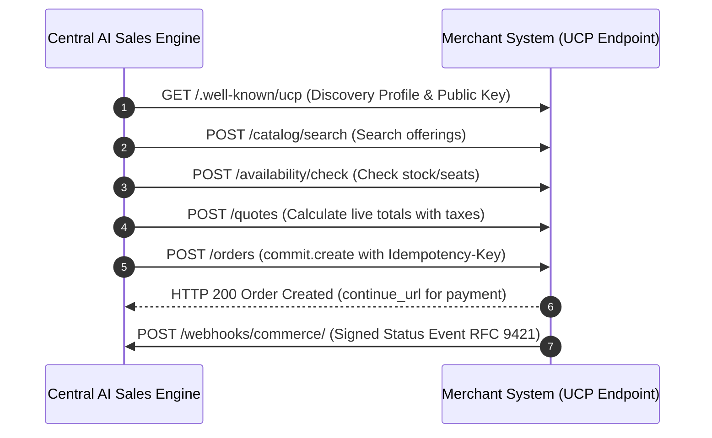

# Feature Detail: Server APIs & Universal Commerce Protocol (UCP)

- **Feature ID**: `MOD-10`, `MOD-15`, `MOD-26`
- **Module Name**: Server-to-Server APIs & Headless Commerce Contract v1.3
- **Audit Status**: Verified Active `[OBSERVED_LIVE]`
- **Primary Route**: `/chat/api/docs/` (Tenant-Facing API Reference)
- **Plan Availability**: Scale, Enterprise

---

## 1. Overview & Architecture
Central AI exposes comprehensive server-to-server APIs for headless conversational AI, automated knowledge ingestion, lead conversion attribution, and bidirectional headless e-commerce.

---

## 2. Authentication & Key Architecture
- **Header**: `X-API-Key: cax_live_...` (Secret external API key).
- **Public Key Sunset**: Requests presenting the public widget key (`ca_...`) receive `HTTP 401 LEGACY_API_KEY_RETIRED`.

---

## 3. Server-to-Server Endpoints Specification

| Method | Endpoint Path | Credential | Origin Check | Functionality |
| :--- | :--- | :--- | :---: | :--- |
| `POST` | `/chat/api/v1/` | `X-API-Key` | Yes | Chat API: `send_message`, `get_history`, `get_sessions`, `new_session`. |
| `POST` | `/knowledge/api/v1/sync/` | `X-API-Key` | No | Knowledge Sync: Asynchronous ingestion of documents and offerings. |
| `POST` | `/api/v1/leads/conversions/` | `X-API-Key` | No | Lead Conversion API: Reports won revenue and conversion events. |
| `GET` | `/api/v1/leads/lookup/` | `X-API-Key` | No | Lead Lookup: Retrieves lead records by `lead_id`, `email`, or `phone`. |
| `GET` | `/api/v1/support/tickets/` | `X-API-Key` | No | Support Tickets API: Queries open/closed tickets. |

---

## 4. Universal Commerce Protocol (UCP) Contract v1.3

Central AI implements an inverted headless commerce contract where the **merchant's system hosts the operations** and Central AI invokes them:

### Idempotency Error Handling
- `idempotency_conflict` (HTTP 409): Non-retryable write rejection (same key, different body).
- `idempotency_in_flight` (HTTP 409): Retryable (first request still running, send `Retry-After`).
- `storage_unavailable` (HTTP 503): Fail closed.

---

## 5. Verification Status & Evidence
- **Observed Live**: Complete 19-table specification verified at `/chat/api/docs/` [OBSERVED_LIVE].
- **Official Documentation**: Verified in `/docs/server-apis/` and `/docs/commerce-api/` [DOCUMENTED].
