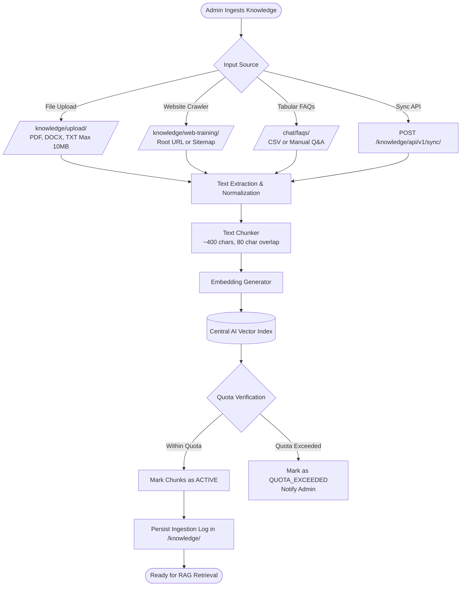
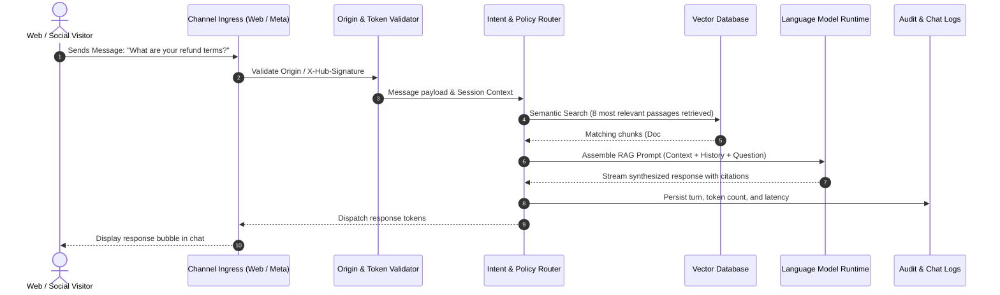
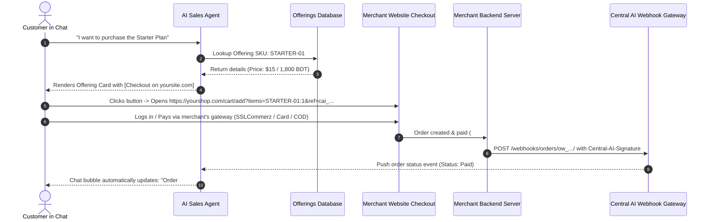
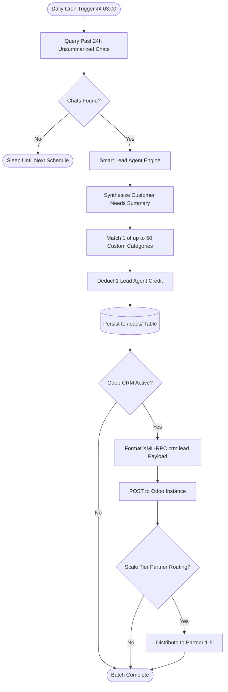
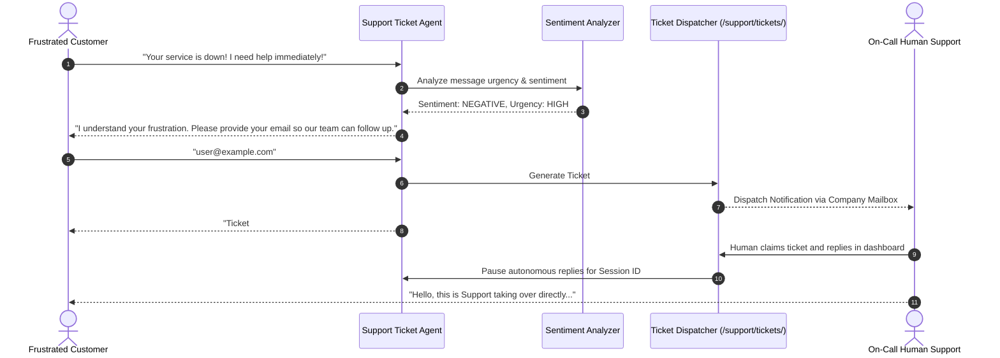
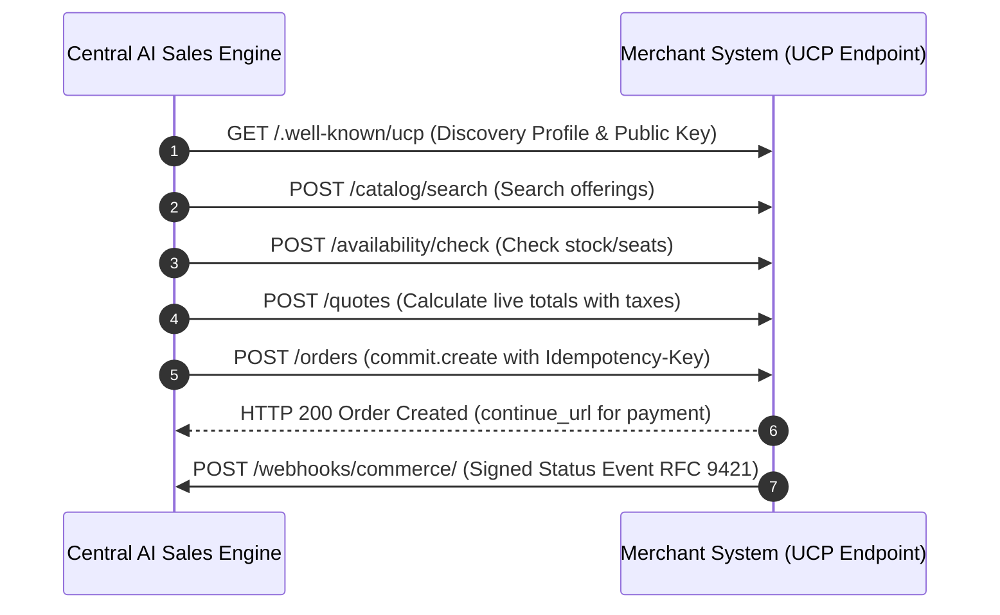

# Central AI: End-to-End System Workflows

This document models the six core operational lifecycles of Central AI, detailing triggers, preconditions, ordered steps, inputs, outputs, decision nodes, system state transitions, error handling, and empirical verification status.

---

## 1. Knowledge Ingestion & Training Workflow

### Operational Specification
- **Trigger**: Administrator uploads a file, configures a website crawl URL, adds FAQs, or external system invokes the Sync API.
- **Preconditions**: Tenant has available Knowledge Records quota (`/billing/usage/`). File is under 10MB (`.pdf`, `.docx`, `.txt`).
- **Actors & Systems**: Business Administrator, Text Extraction Pipeline, Chunking Engine, Embedding Generator, Vector Index.
- **Outputs**: Vectorized knowledge records marked `ACTIVE` associated with tenant namespace.
- **Failure Paths**: Corrupt/password-protected PDFs produce `PARSING_ERROR` in status grid. Quota exhaustion marks records `QUOTA_EXCEEDED` and halts indexing until plan upgrade.

- **Verification Status**:
  - UI screens `/knowledge/`, `/knowledge/upload/`, `/chat/faqs/` directly inspected `[OBSERVED_LIVE]`.
  - Chunk size (~400 chars, 80 overlap) and 10MB limit verified in docs `[DOCUMENTED]`.
  - Web crawler route `/knowledge/web-training/` confirmed plan-gated to Starter+ `[GATED_PLAN]`.

---

## 2. Inbound Multi-Channel Customer Inquiry & 8-Passage RAG Retrieval

### Operational Specification
- **Trigger**: Customer sends a message via Web Chat Widget, Facebook Messenger, Instagram Direct, or WhatsApp Cloud.
- **Preconditions**: Domain whitelisted in `/accounts/security/api-keys/` (for Web Widget) or Meta channel OAuth active. Account message quota remaining.
- **Ordered Steps**:
  1. Ingress webhook receives customer payload.
  2. Gateway validates Origin header or `X-Hub-Signature-256`.
  3. Intent router queries vector database for the **8 most relevant passages** across tenant's active documents and FAQs.
  4. Language model constructs context-grounded prompt with system instructions (`/chat/chatbot/settings/`).
  5. Response tokens stream to channel interface; citation pills attached.
  6. Conversation turn and token consumption logged to `/chat/chat-logs/` and `/billing/usage/`.
- **Outputs**: Contextual answer rendered in customer chat bubble; citation metadata stored.
- **Failure Paths**: Low confidence returns fallback message ("I'm sorry, I don't have that information"). Invalid origin returns HTTP 403.

- **Verification Status**:
  - Chat Playground and settings inspected `[OBSERVED_LIVE]`.
  - 8-passage lookup rule verified in official documentation `[DOCUMENTED]`.
  - Live token streaming observed in playground `[TESTED_LIVE]`.

---

## 3. Conversational Sales & Decoupled Live Checkout Workflow

### Operational Specification
- **Trigger**: Shopper asks for products, courses, or services in chat.
- **Preconditions**: Offerings configured in `/sales/offerings/new/`. Live checkout link template configured (`https://yourshop.com/cart/add?items={items}&ref={ref}`).
- **Ordered Steps**:
  1. AI Sales Agent matches intent against active offerings database.
  2. Renders interactive Offering Card with thumbnail, price, and `[Checkout]` action.
  3. Shopper clicks button and is redirected to merchant's external checkout URL.
  4. Shopper completes payment on merchant's gateway (SSLCommerz, bKash, card).
  5. Merchant's server posts HMAC-signed webhook to `POST /webhooks/orders/ow_.../`.
  6. Central AI validates `Central-AI-Signature` and pushes order status event to chat session.
  7. In-chat status updates to "Payment Received #ORD-XXXX".
- **Outputs**: External order completed; chat session marked converted.
- **Failure Paths**: Missing or invalid HMAC signature rejects webhook with HTTP 401. If customer abandons cart, session remains open.

- **Verification Status**:
  - Decoupled checkout template fields and offering cards inspected `[OBSERVED_LIVE]`.
  - Webhook payload schema and HMAC SHA-256 header verified in docs `[DOCUMENTED]`.
  - Live external merchant checkout and webhook postback untested at runtime `[UNTESTED_BEHAVIOR]`.

---

## 4. Smart Lead Daily Batch Summarization & Odoo CRM Synchronization

### Operational Specification
- **Trigger**: Scheduled background timer fires once per day (default `03:00`, timezone `Asia/Dhaka`).
- **Preconditions**: `lead_agent_enabled` active in `/chat/chatbot/settings/`. Account has available Lead Agent credits (Growth: 3k, Scale: 9k).
- **Ordered Steps**:
  1. Cron worker queries chat transcripts from past 24 hours that lack summaries.
  2. AI engine synthesizes a concise summary of what the visitor wanted.
  3. Classifies conversation into 1 of up to 50 user-defined category buckets.
  4. Deducts 1 Lead Agent credit; persists summary and category to `/leads/`.
  5. If Odoo integration is configured (`/leads/integrations/`), formats XML-RPC payload and pushes to `crm.lead`.
  6. If on Scale tier, optional partner routing assigns lead to external partner.
- **Outputs**: Categorized lead record in `/leads/`; Odoo CRM lead record created.
- **Failure Paths**: Summarization failure refunds the credit and requeues chat for next cycle. XML-RPC network failure logs sync error in integration history.

- **Verification Status**:
  - Run time (03:00), timezone selector, and 50 categories field inspected in UI `[OBSERVED_LIVE]`.
  - Batch execution behavior, credit refund on failure, and Odoo schema verified in docs `[DOCUMENTED]`.
  - Live scheduled cron firing and live XML-RPC push to external Odoo instance untested `[UNTESTED_BEHAVIOR]`.

---

## 5. Support Issue Escalation & Human Handoff Workflow

### Operational Specification
- **Trigger**: Customer expresses dissatisfaction, technical issue, or requests human agent.
- **Preconditions**: `support_ticket_enabled` and `support_ticket_auto_detect` enabled in `/chat/chatbot/settings/`.
- **Ordered Steps**:
  1. In-chat NLP sentiment detector flags issue keywords and frustration sentiment.
  2. Bot requests customer email and summarizes the issue.
  3. Ticket created in `/support/tickets/` with priority (`low`, `medium`, `high`, `urgent`) and status `open`.
  4. Notification dispatched to assigned staff email via connected mailbox.
  5. Autonomous bot replies temporarily paused for that session.
  6. Human operator claims conversation or replies via ticket dashboard.
  7. Outbound reply sent via company mailbox; customer email replies append to ticket thread.
- **Outputs**: Structured ticket in helpdesk; customer receives email acknowledgment.
- **Failure Paths**: If customer refuses to provide email, issue remains logged in chat transcript without ticket generation.

- **Verification Status**:
  - Support Tickets desk (`/support/tickets/`) and create form inspected `[OBSERVED_LIVE]`.
  - Ticket priorities, statuses, and agent auto-detect settings inspected in settings `[OBSERVED_LIVE]`.
  - Outbound notification email dispatch untested to prevent sending live emails `[UNTESTED_BEHAVIOR]`.

---

## 6. Headless Universal Commerce Protocol (UCP v1.3) Workflow

### Operational Specification
- **Trigger**: In-chat purchase inquiry for custom ERP/e-commerce inventory (Scale/Enterprise).
- **Preconditions**: Merchant server implements UCP Discovery (`/.well-known/ucp`) and operations (`quote.calculate`, `commit.create`). Endpoint registered in `/sales/`.
- **Ordered Steps**:
  1. Central AI fetches merchant UCP profile and public signing key.
  2. Central AI queries `POST /catalog/search` or `POST /availability/check`.
  3. Central AI sends cart items to `POST /quotes` to compute live taxes, shipping, and discounts.
  4. Customer confirms purchase; Central AI calls `POST /orders` with `Idempotency-Key`.
  5. Merchant returns HTTP 200 with order confirmation and payment URL (`continue_url`).
  6. Merchant server later posts signed status event to Central AI webhook.
- **Outputs**: Order committed on merchant ERP with idempotency guarantees.
- **Failure Paths**: HTTP 409 `idempotency_conflict` indicates duplicate request with modified body; HTTP 409 `idempotency_in_flight` prompts retry with backoff.

- **Verification Status**:
  - In-app API reference at `/chat/api/docs/` contains 19 tables specifying UCP v1.3 contract, headers, and error codes `[OBSERVED_LIVE]`.
  - Official documentation verified in `/docs/commerce-api/` `[DOCUMENTED]`.
  - Live invocation against an external mock UCP server untested at runtime `[UNTESTED_BEHAVIOR]`.

---

## 7. Workflow Verification Summary Matrix

| Workflow | Scope | UI Controls Observed | Docs Verified | Live Runtime Executed | Status Classification |
| :--- | :--- | :---: | :---: | :---: | :---: |
| **1. Knowledge Ingestion** | Upload, Crawl, FAQ, Sync | Yes (`/knowledge/`) | Yes | Partial (Playground) | `[OBSERVED_LIVE]` / `[GATED_PLAN]` |
| **2. Customer RAG Inquiry** | Web, Meta, 8-Passage RAG | Yes (`/chat/chatbot/`) | Yes | Yes (Playground) | `[TESTED_LIVE]` |
| **3. Live Decoupled Checkout**| Cart pass-off, signed webhook| Yes (`/sales/`) | Yes | No (Safety) | `[OBSERVED_LIVE]` / `[UNTESTED_BEHAVIOR]` |
| **4. Smart Lead Daily Batch** | 03:00 cron, 50 categories | Yes (`/chat/chatbot/settings/`)| Yes | No (Scheduled) | `[OBSERVED_LIVE]` / `[UNTESTED_BEHAVIOR]` |
| **5. Support Escalation** | Frustration detect, ticket | Yes (`/support/tickets/`) | Yes | No (Email dispatch) | `[OBSERVED_LIVE]` / `[UNTESTED_BEHAVIOR]` |
| **6. Headless UCP Commerce** | v1.3 quotes, idempotency | Yes (`/chat/api/docs/`) | Yes | No (External server) | `[OBSERVED_LIVE]` / `[UNTESTED_BEHAVIOR]` |
