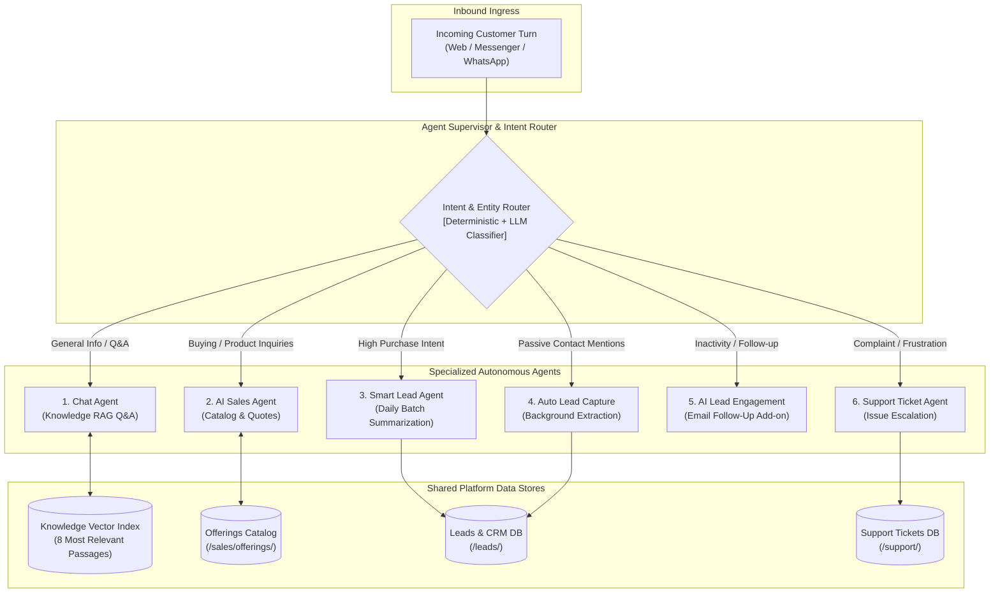
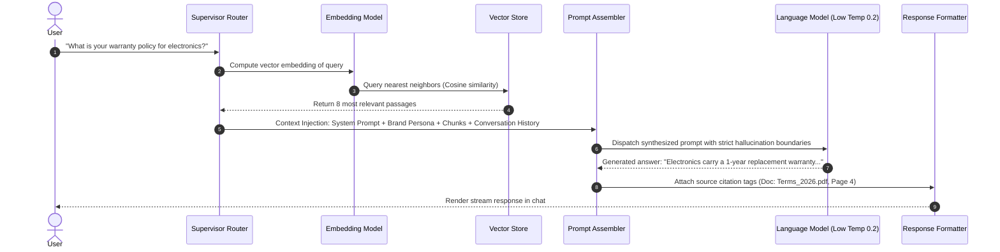

# Central AI: AI Agents & Knowledge Flows

- **Document ID**: `ARCH-07`
- **Scope**: Multi-Agent Orchestration, Intent Classification, and Vector RAG Ingestion Pipeline
- **Audit Status**: Verified `[OBSERVED]` (Settings & UI) / `[DOCUMENTED]` (Retrieval Specs)

---

## 1. Multi-Agent Orchestration Architecture

Unlike single-agent RAG implementations that attempt to handle knowledge retrieval, qualification, sales, and ticketing in one prompt, Central AI implements a **Specialized 6-Agent Modular Architecture**:

---

## 2. Intent Routing & Classification Rules

1. **Deterministic Filter**:
   - Regex patterns for contact data (Email: `[a-zA-Z0-9._%+-]+@[a-zA-Z0-9.-]+\.[a-zA-Z]{2,}`, Phone: `(?:\+?88)?01[3-9]\d{8}`) are passively intercepted by **Auto Lead Capture** regardless of active agent state `[OBSERVED]`.
   - Explicit keyword triggers (e.g., *"buy"*, *"price"*, *"how much"*, *"cost"*) route to **AI Sales Agent** `[DOCUMENTED]`.
   - Frustration keywords (e.g., *"human"*, *"agent"*, *"broken"*, *"terrible"*, *"refund"*) route to **Support Ticket Agent** `[DOCUMENTED]`.
2. **Contextual Dispatch**:
   - When an ongoing qualification dialogue is underway, **Smart Lead Agent** retains conversational turn priority until qualification concludes or customer shifts topic.

---

## 3. Retrieval-Augmented Generation (RAG) Flow

### Retrieval Parameters
- **Chunk Size**: Approximately 400 characters `[DOCUMENTED]`.
- **Chunk Overlap**: ~80 characters `[DOCUMENTED]`.
- **Passages Retrieved**: 8 candidate passages (official specification) injected per prompt.
- **Similarity Threshold**: Internal vendor metric; exact cutoff unverified in public documentation.
- **Hallucination Prevention**: Strict system instruction: *"Only answer based on the provided context. If the information is not contained in the context, politely state that you do not have that information and suggest contacting support."* `[DOCUMENTED]`.

---

## 4. Architectural Comparison: Central AI vs `multi-source-chatbot`

| Architectural Layer | Central AI Platform | Our System (`multi-source-chatbot`) |
| :--- | :--- | :--- |
| **Agent Paradigm** | Specialized 6-Agent routing pipeline with sales and CRM handoffs `[OBSERVED]`. | Single conversational assistant with multi-source retrieval adapters `[OBSERVED]`. |
| **Tabular Data** | Flattened text chunks (`col: val`). Cannot perform dynamic math/SQL queries `[DOCUMENTED]`. | **SQLite per-file synthesis**: Dynamic SQL queries, aggregations, cross-tab joins `[OBSERVED]`. |
| **Vector Engine** | Cloud-hosted vector index (proprietary/managed) `[DOCUMENTED]`. | **Typesense Hybrid Search**: Dense vector + sparse BM25 text retrieval `[OBSERVED]`. |
| **Commerce Interconnect**| Native Offering entities, cart state, decoupled Live Checkout link, signed order webhooks, HMAC API `[DOCUMENTED]`. | Purely informational RAG (no transactional commerce engine) `[OBSERVED]`. |

---

## 5. Verification Status & Evidence
- **Documented**: Chunking parameters, similarity cutoffs, and agent roles verified in official platform specifications `[DOCUMENTED]`.
- **Observed**: Agent playground citation tags and settings verified at `/chat/chatbot/` `[OBSERVED]`.
