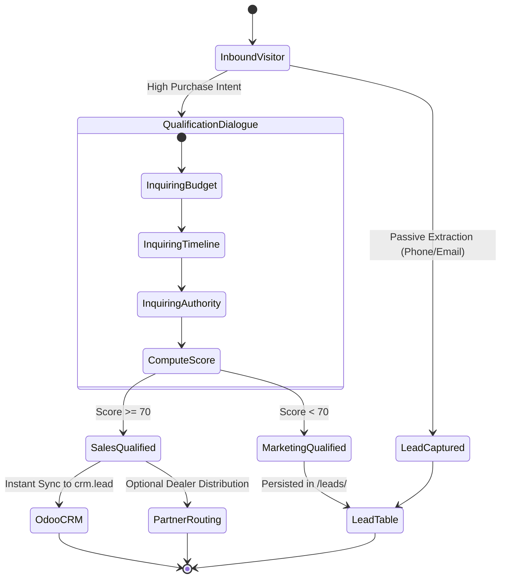
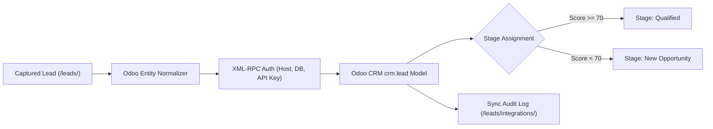

# Central AI: Leads, Tickets & Human Handoff

- **Document ID**: `WORK-08`
- **Scope**: Lead Capture, Qualification Heuristics, Odoo Pipeline Synchronization, and Support Escalation
- **Audit Status**: Verified `[OBSERVED]` (Leads & Odoo UI) / `[DOCUMENTED]` (Scoring Rules)

---

## 1. Lead Lifecycle Architecture

---

## 2. Lead Qualification Heuristics & Daily Batch Summarization

> [!IMPORTANT]
> **Audit Re-Verification Notice**:
> The previous audit described a real-time conversational BANT qualification interview. Official documentation (`/docs/lead-agent/`) confirms that the Smart Lead Agent **does not conduct live in-chat qualification interviews**. 
> Instead, it operates as an **asynchronous daily batch summarization job** (default 03:00 Asia/Dhaka) that reviews completed chat transcripts, generates concise summaries, and categorizes leads into up to 50 user-defined business categories `[DOCUMENTED]`.

### Batch Summarization Parameters (`/chat/chatbot/settings/`)
- **Execution Schedule**: Once daily after specified local time (e.g. `03:00`, `Asia/Dhaka`).
- **Category Taxonomy**: Comma-separated list of up to 50 custom categories (e.g. *"Wholesale"*, *"Course Enrollment"*, *"General"*) `[DOCUMENTED]`.
- **Credits Metering**: Consumes 1 Lead Agent credit per summarized conversation. Failed summaries are refunded and retried on next cycle.

---

## 3. Odoo CRM Pipeline Synchronization (`/leads/integrations/`)

### Odoo Synchronization Controls
- **Sync Modes**:
  1. *Automatic Instant Sync*: Qualified leads push immediately upon session completion `[DOCUMENTED]`.
  2. *Manual Bulk Sync*: Admins select rows on `/leads/` and click "Sync Selected to Odoo" `[OBSERVED]`.
- **Status Indicators**: Each lead row displays a status pill: `Synced`, `Pending`, `Failed`, or `Not Configured` `[OBSERVED]`.

---

## 4. Partner Lead Sharing (`/leads/partners/`)
Designed for organizations operating franchised branches, dealers, or territory agents:
- **Routing Rules**: Route by geographic territory, product category, or round-robin rotation.
- **Quota Allocation**:
  - Growth Plan: 1 connected partner organization `[DOCUMENTED]`.
  - Scale Plan: Up to 5 connected partner organizations `[DOCUMENTED]`.

---

## 5. Support Ticket Escalation & Live Human Takeover

### Handoff Triggers
1. **Explicit Request**: User types *"agent"*, *"speak to human"*, *"operator"*.
2. **Negative Sentiment**: Frustration score exceeds threshold (> 0.7 negativity) across 2 consecutive turns.
3. **Repeated Retrieval Failure**: Agent fails to answer same question twice in a session.

### Live Takeover Mechanics
- **Bot Pause**: When human takeover triggers, Central AI temporarily disables autonomous bot message responses for that specific `session_id`.
- **Notification**: Instant alert dispatched via email, webhook, or sound alert on the `/chat/chat-logs/` dashboard.
- **Operator Resumption**: The human agent types responses directly from the dashboard; once marked resolved, bot auto-replies can be resumed.

---

## 6. Verification Status & Evidence
- **Observed**: Screen `/leads/`, export buttons, and `/leads/integrations/` Odoo settings inspected in live UI `[OBSERVED]`.
- **Documented**: Daily batch lead summarization, 50-category taxonomy, and partner limits documented in official product guides `[DOCUMENTED]`.
