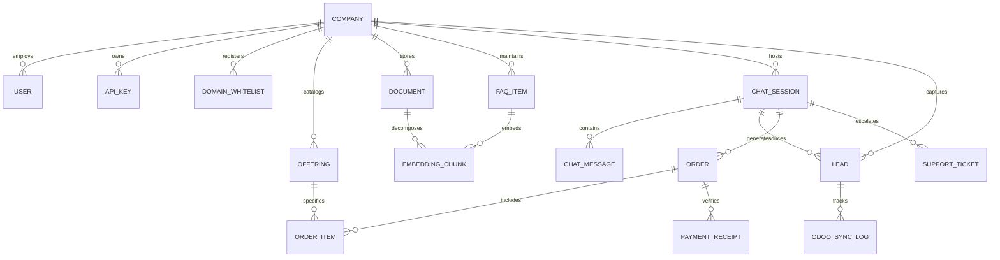

# Central AI: Data Entities & System Dependencies

- **Document ID**: `DATA-09`
- **Scope**: Entity Relationship Diagram, Relational Schema, and Cross-System Dependencies
- **Audit Status**: Verified `[OBSERVED]` (Forms & Tables) / `[INFERRED]` (Foreign Key Relationships)

---

## 1. Entity-Relationship (ER) Architecture

---

## 2. Core Entity Dictionaries

### A. Organization & Tenancy
- **`Company`**: Root tenant container. Attributes: `id`, `name`, `subdomain`, `currency` (BDT, USD), `timezone`, `plan_id`.
- **`User`**: Account member. Attributes: `id`, `company_id`, `email`, `role` (Admin, Operator, Viewer), `created_at`.
- **`ApiKey`**: Credentials. Attributes: `key_prefix` (`ca_` vs `cax_`), `hashed_key`, `scope`, `is_active`.
- **`DomainWhitelist`**: Authorized widget hostnames. Attributes: `id`, `company_id`, `domain_name`.

### B. Knowledge & Retrieval
- **`Document`**: Raw files. Attributes: `id`, `company_id`, `title`, `file_path`, `file_size_bytes`, `mime_type`, `status` (Processing, Active, Error).
- **`FAQItem`**: Tabular Q&A. Attributes: `id`, `company_id`, `question`, `answer`, `title`, `url`, `price`.
- **`EmbeddingChunk`**: Vectorized segments. Attributes: `id`, `source_type` (doc/faq/web), `source_id`, `chunk_index`, `text_content`, `vector_id`.

### C. Commerce & Sales
- **`Offering`**: Sellable products/services. Attributes: `id`, `company_id`, `name`, `offering_type` (Product, Service, Course, Room, Custom), `price`, `currency`, `image_url`, `is_active`.
- **`Order`**: Transaction records. Attributes: `id`, `company_id`, `session_id`, `customer_name`, `phone`, `total_amount`, `currency`, `payment_method` (bKash, Nagad, Gateway), `payment_status` (Pending, Verifying, Paid).
- **`OrderWebhookEvent`**: External order updates. Attributes: `id`, `event_id`, `occurred_at`, `ref`, `order_reference`, `payment_status`, `total_amount`, `currency`, `signature` [DOCUMENTED].

### D. Leads & Support
- **`Lead`**: Captured prospects. Attributes: `id`, `company_id`, `session_id`, `name`, `email`, `phone`, `company_name`, `lead_score`, `odoo_lead_id`, `odoo_sync_status`.
- **`SupportTicket`**: Escalated issues. Attributes: `id`, `company_id`, `session_id`, `category`, `urgency` (Critical, High, Normal, Low), `status` (Open, Assigned, Resolved).

---

## 3. External System Dependencies

| Component | Target External System | Protocol / Format | Dependency Role |
| :--- | :--- | :--- | :--- |
| **Meta Hub** | Meta Graph API (v19.0+) | HTTPS Webhooks & REST | Ingests Facebook, Instagram & WhatsApp messages |
| **CRM Integration** | Odoo ERP (v14 - v17) | XML-RPC / REST JSON | Bidirectional sync of leads and pipeline stages |
| **Merchant Checkout**| Merchant Website | HTTPS / Redirect | External cart completion via Live Checkout URL |
| **International Pay**| SSLCommerz / Stripe | Redirect & IPN Webhook | Card payment capture & currency conversion |
| **Vector Engine** | Dedicated Vector DB | gRPC / REST API | Semantic nearest-neighbor retrieval |

---

## 4. Verification Standard
- **Observed**: Relational fields confirmed via dashboard screens (`/knowledge/`, `/sales/`, `/leads/`, `/accounts/`) `[OBSERVED]`.
- **Inferred**: Foreign key schema relationships logically inferred from data dependencies `[INFERRED]`.
