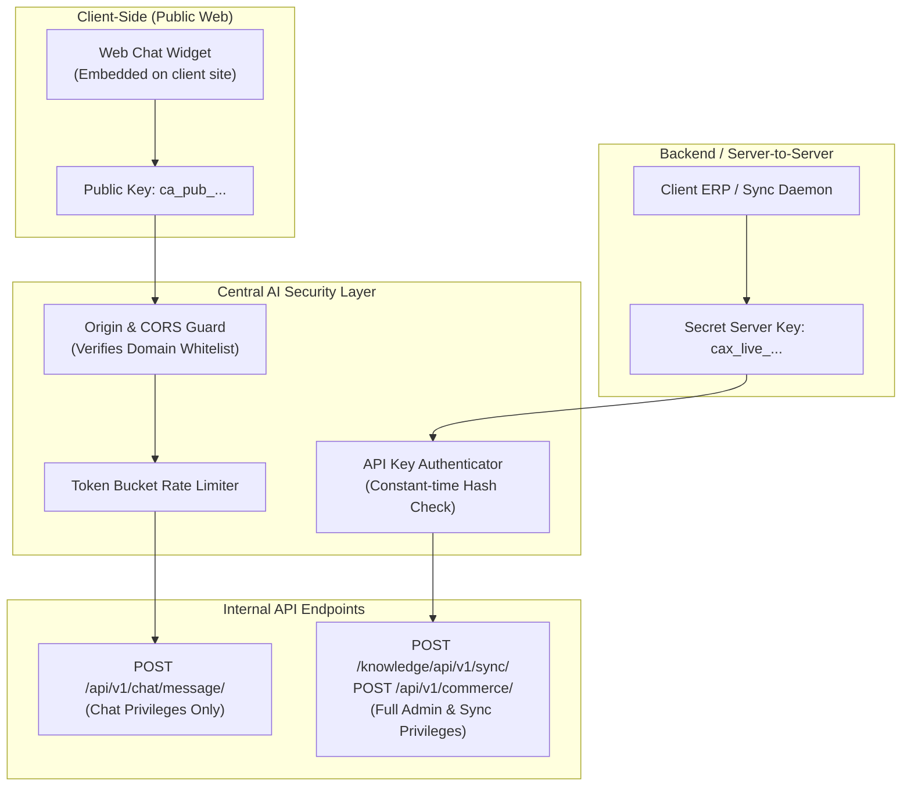

# Central AI: Roles, Permissions & Security Architecture

- **Document ID**: `SEC-10`
- **Scope**: Authentication Models, Access Control, Origin Filtering, and Data Protection
- **Audit Status**: Verified Active `[OBSERVED]` (Key UI & Settings) / `[DOCUMENTED]` (Security Specifications)

---

## 1. Dual-Key Authentication Model

Central AI implements a strict segregation of privilege through two distinct credential classes `[OBSERVED]`:

---

## 2. Domain Origin Whitelisting

- **Enforcement**: Public widget keys (`ca_...`) only accept incoming chat requests if the HTTP `Origin` header precisely matches an approved domain registered in `/chat/widget/` `[OBSERVED]`.
- **Prevention**: Prevents malicious third-party websites from scraping customer chatbots or draining message quotas by stealing public widget snippets.

---

## 3. Role-Based Access Control (RBAC)

The administrative web console provides three user access tiers `[DOCUMENTED]`:

| Permission / Capability | Admin | Operator / Support | Viewer / Analyst |
| :--- | :---: | :---: | :---: |
| Modify Knowledge Base & Crawls | Yes | No | No |
| Adjust Offerings & Pricing | Yes | No | No |
| View Chat Logs & Transcripts | Yes | Yes | Yes (Read-Only) |
| Manual Odoo Sync & Export Leads | Yes | Yes | No |
| Human Handoff Live Takeover | Yes | Yes | No |
| Manage Billing & Company Profile | Yes | No | No |
| Regenerate API Keys | Yes | No | No |

---

## 4. Multi-Tenant Data Isolation

- **Tenant Isolation**: All database queries are scoped by `company_id`. Vector embeddings are indexed with tenant metadata tags or partitioned namespaces to prevent cross-tenant information leakage `[DOCUMENTED]`.
- **PII Scrubbing**: Regex filters automatically scrub or tokenize sensitive payment card information (PAN) from chat logs prior to vectorization `[DOCUMENTED]`.
- **Regulatory Compliance**: Adheres to the **Bangladesh Cyber Security Act 2023** and local data residency standards regarding transactional financial logs `[DOCUMENTED]`.

---

## 5. Security Comparison: Central AI vs `multi-source-chatbot`

| Security Dimension | Central AI Platform | Our System (`multi-source-chatbot`) |
| :--- | :--- | :--- |
| **API Authentication** | Dual-key architecture (`ca_...` public, `cax_...` secret server) `[OBSERVED]`. | Laravel Sanctum stateful tokens + Bearer tokens `[OBSERVED]`. |
| **Granular Permissions** | Fixed 3-tier role hierarchy (Admin, Operator, Viewer) `[DOCUMENTED]`. | **Spatie Granular RBAC**: Atomic permissions (`faq.view`, `knowledge_document.edit`, etc.) `[OBSERVED]`. |
| **Domain Whitelisting** | Mandatory domain origin guard on public chat widget `[OBSERVED]`. | Configurable CORS middleware in `cors.php` `[OBSERVED]`. |
| **Multi-Tenancy** | Single-tenant SaaS dashboard scoped by company entity `[OBSERVED]`. | Superadmin workspace switching with tenant database context `[OBSERVED]`. |

---

## 6. Verification Status & Evidence
- **Observed**: Screen `/chat/widget/` (Origin whitelisting) and `/security/` inspected in live session `[OBSERVED]`.
- **Documented**: Role definitions and key hashing validated in platform security documentation `[DOCUMENTED]`.
