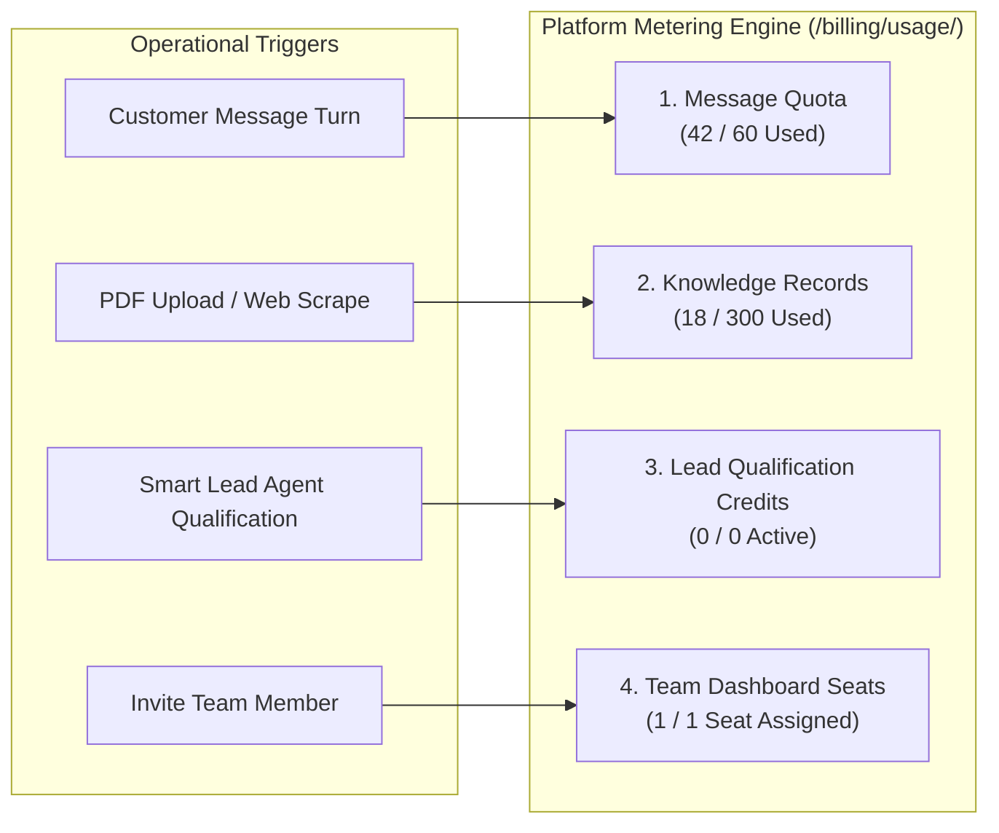

# Central AI: Billing, Usage & Plan Limits

- **Document ID**: `BILL-11`
- **Scope**: Commercial Pricing Structure, Resource Quotas, Rate Limits, and Metering Architecture
- **Audit Status**: Verified Active `[OBSERVED]` (Live Usage UI) / `[DOCUMENTED]` (Official Pricing Matrix)

---

## 1. Comprehensive Subscription Tier Matrix

Central AI packages its platform across five commercial tiers `[DOCUMENTED]` / `[OBSERVED]`:

| Feature / Resource Dimension | Test Drive (Free) | Starter ($15 / mo) (~1,800 BDT) | Growth ($50 / mo) (~6,200 BDT) | Scale ($150 / mo) (~18,600 BDT) | Enterprise / Custom |
| :--- | :--- | :--- | :--- | :--- | :--- |
| **Validity / Term** | 7 Days Trial | Monthly / Annual | Monthly / Annual | Monthly / Annual | Tailored SLA |
| **Monthly Messages** | 60 messages | 3,000 messages | 15,000 messages | 50,000 messages | Unlimited / Pooled |
| **Knowledge Base Records** | 300 records | 3,000 records | 10,000 records | 50,000 records | Dedicated Quota |
| **Administrative Seats** | 1 user | 4 team seats | 10 team seats | 20 team seats | Custom Seats |
| **Product Offerings Limit** | 5 offerings | 50 offerings | 500 offerings | Unlimited | Unlimited |
| **Lead Qualification Credits**| 0 credits | 0 credits | 3,000 credits | 9,000 credits | Custom Quota |
| **Supported Channels** | Web Widget only | Web + Facebook | Web + FB + IG + WhatsApp | All Channels | All + Custom API |
| **Lead Capture & CRM** | Auto Lead Capture | Disabled | Auto Lead (500/mo) + Smart Lead (3k) + Odoo | Smart Lead + Odoo CRM | Advanced Custom CRM |
| **Partner Lead Routing** | Disabled | Disabled | 1 Partner Network | 5 Partner Networks | Unlimited Networks |
| **Commerce & Checkout** | Disabled | Manual MFS (bKash/Nagad)| MFS + Gateways | MFS + Gateways + API | Custom ERP Hooks |
| **Branding** | Central AI badge | Central AI badge | Central AI badge | **White-Label Removed**| White-Label |

---

## 2. Metered Resource Dimensions (`/billing/usage/`)

The platform actively tracks four metered units in real time `[OBSERVED]`:

### Consumption Rules
1. **Message Turns**: Each incoming user message processed and answered by an agent decrements the message pool by 1. System-level errors or blocked origin attempts are not billed `[DOCUMENTED]`.
2. **Knowledge Records**: Calculated as the sum of text chunks (~400 characters each) stored in the vector database across uploaded documents, scraped webpages, and manual FAQ entries `[DOCUMENTED]`.
3. **Lead Agent Credits**: Deducted strictly when the Smart Lead Agent executes a daily batch summarization on an unsummarized chat conversation (1 credit per conversation) `[DOCUMENTED]`.

---

## 3. Quota Enforcement & Overage Behavior

- **Soft Warnings**: The dashboard banner displays warning notices when message consumption reaches **80%** and **95%** of the monthly tier ceiling `[DOCUMENTED]`.
- **Hard Limit Rejection**: Upon reaching 100% of the allocated message quota:
  - The public chat widget responds with a fallback service notice: *"Our chat service is temporarily unavailable. Please contact our support team via email or phone."*
  - Server-to-server API calls return `HTTP 429 Too Many Requests` with a JSON payload: `{"error": "quota_exceeded", "code": "ERR_MSG_LIMIT"}` `[DOCUMENTED]`.
- **Knowledge Base Lockdown**: When record limits are reached, file uploads and web training crawler jobs are paused until old records are deleted or the subscription is upgraded `[OBSERVED]`.

---

## 4. Payment Methods & Billing Lifecycle
- **Supported Payment Gateways**: bKash, Nagad, Visa, Mastercard, American Express, and SSLCommerz direct debit `[DOCUMENTED]`.
- **Invoicing**: Monthly tax-compliant PDF invoices are automatically generated and downloadable from `/billing/invoices/` `[OBSERVED]`.

---

## 5. Verification Status & Evidence
- **Observed**: Screen `/billing/usage/` directly inspected during active session, confirming live progress bars for messages, records, seats, and lead credits `[OBSERVED]`.
- **Documented**: Tier boundaries, pricing in USD/BDT, and white-labeling rules verified in the official Central AI pricing matrix `[DOCUMENTED]`.
