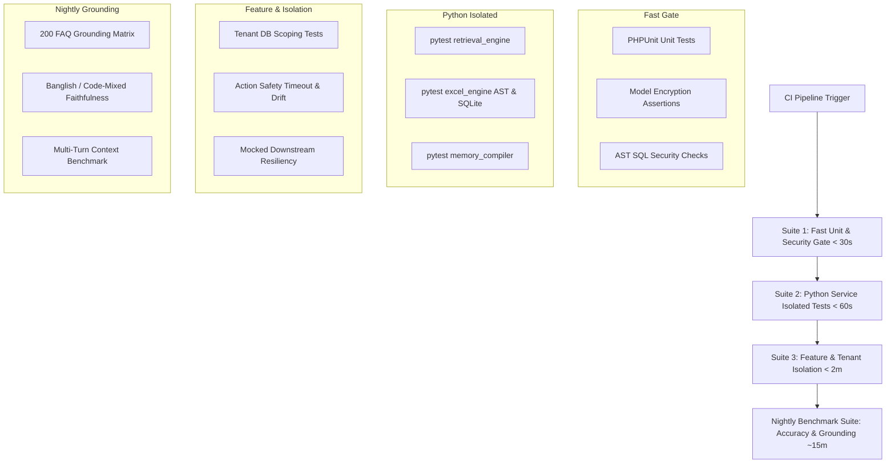

# Existing Feature Audit — Test Coverage & Validation Plan

## 1. Executive Summary

This document establishes the test coverage baseline across the `multi-source-chatbot` platform and its Python microservices (`python-ai-service`, `python-memory-service`). It maps existing automated test suites to core platform capabilities, highlights critical missing test scenarios exposed during the quality audit, defines safe reproduction procedures, and specifies exact quantitative validation metrics required to verify each recommended improvement in [06_PRIORITIZED_IMPROVEMENT_BACKLOG.md](file:///Users/zesan/Desktop/Entrepreneurs_Automation/multi-source-chatbot/docs/product-audit/existing-feature-improvements/06_PRIORITIZED_IMPROVEMENT_BACKLOG.md).

---

## 2. Existing Test Coverage Mapped to Capabilities

The platform benefits from an extensive test suite comprising PHPUnit/Pest tests in Laravel and `pytest` suites in the Python services.

| Capability Scope | Test Level | Existing Test Files | Key Assertions & Scenarios Covered | Coverage Status |
| :--- | :--- | :--- | :--- | :--- |
| **A. Routing & Intent Classification** | Unit | [HybridRouterTest.php](file:///Users/zesan/Desktop/Entrepreneurs_Automation/multi-source-chatbot/tests/Unit/AI/HybridRouterTest.php)<br>[SemanticRoutingDecouplingTest.php](file:///Users/zesan/Desktop/Entrepreneurs_Automation/multi-source-chatbot/tests/Unit/AI/SemanticRoutingDecouplingTest.php) | Route decisions for CHAT, KNOWLEDGE, ANALYTICS, OOD; mock DeepSeek JSON payloads; fallback on LLM failure. | **HIGH (Mocked)** |
| | Feature / E2E | [E2E08OODQueryRejectionTest.php](file:///Users/zesan/Desktop/Entrepreneurs_Automation/multi-source-chatbot/tests/Feature/E2E/E2E08OODQueryRejectionTest.php)<br>[ClarificationE2ETest.php](file:///Users/zesan/Desktop/Entrepreneurs_Automation/multi-source-chatbot/tests/Feature/ClarificationE2ETest.php)<br>[E2EMultiTurnBenchmarkTest.php](file:///Users/zesan/Desktop/Entrepreneurs_Automation/multi-source-chatbot/tests/Feature/E2EMultiTurnBenchmarkTest.php) | Intent switching across turns; out-of-domain rejections; multi-turn clarification prompting. | **MEDIUM (Synthetic)** |
| | Live | [LiveLlmRouterTest.php](file:///Users/zesan/Desktop/Entrepreneurs_Automation/multi-source-chatbot/tests/Feature/Live/LiveLlmRouterTest.php) | Real API calls to remote LLM (DeepSeek/OpenRouter) verifying prompt contract and JSON response parsing. | **LOW (API Dependent)** |
| **B. Retrieval & AI Answer Quality** | Unit | [RetrievalClientTest.php](file:///Users/zesan/Desktop/Entrepreneurs_Automation/multi-source-chatbot/tests/Unit/Services/RetrievalClientTest.php)<br>[SemanticAnswerabilityGateTest.php](file:///Users/zesan/Desktop/Entrepreneurs_Automation/multi-source-chatbot/tests/Unit/AI/SemanticAnswerabilityGateTest.php)<br>[ContextualQueryBuilderTest.php](file:///Users/zesan/Desktop/Entrepreneurs_Automation/multi-source-chatbot/tests/Unit/AI/ContextualQueryBuilderTest.php) | HTTP client timeout handling; fallback to DB SQL; answerability thresholds; pronoun resolution query rewrite. | **HIGH (Mocked)** |
| | Feature / Python | [test_retrieval_relevance_benchmark.py](file:///Users/zesan/Desktop/Entrepreneurs_Automation/python-ai-service/tests/test_retrieval_relevance_benchmark.py)<br>[test_dense_embedding_retrieval.py](file:///Users/zesan/Desktop/Entrepreneurs_Automation/python-ai-service/tests/test_dense_embedding_retrieval.py)<br>[StaticKnowledge200BenchmarkTest.php](file:///Users/zesan/Desktop/Entrepreneurs_Automation/multi-source-chatbot/tests/Feature/StaticKnowledge200BenchmarkTest.php) | Dense vector search, hybrid RRF fusion, Typesense score normalization, 200-question FAQ retrieval benchmark. | **HIGH (Isolated Fixtures)** |
| **C. Conversation Memory** | Unit | [MemoryRelevanceGateTest.php](file:///Users/zesan/Desktop/Entrepreneurs_Automation/multi-source-chatbot/tests/Unit/Services/MemoryRelevanceGateTest.php)<br>[EntityExtractorTest.php](file:///Users/zesan/Desktop/Entrepreneurs_Automation/multi-source-chatbot/tests/Unit/Services/EntityExtractorTest.php) | Entity extraction from Bengali/English text; memory gating based on cosine similarity and token limits. | **HIGH (Mocked)** |
| | Feature / Integration | [ConversationMemoryPipelineTest.php](file:///Users/zesan/Desktop/Entrepreneurs_Automation/multi-source-chatbot/tests/Feature/ConversationMemoryPipelineTest.php)<br>[ConversationMemoryServiceTest.php](file:///Users/zesan/Desktop/Entrepreneurs_Automation/multi-source-chatbot/tests/Feature/ConversationMemoryServiceTest.php)<br>[E2E07PythonMemoryKGMTest.php](file:///Users/zesan/Desktop/Entrepreneurs_Automation/multi-source-chatbot/tests/Feature/E2E/E2E07PythonMemoryKGMTest.php) | Pipeline dispatch of `IngestConversationMemoryJob`; HTTP client communication with `python-memory-service`. | **MEDIUM (Service Mocks)** |
| | Python Service | [test_memory_service.py](file:///Users/zesan/Desktop/Entrepreneurs_Automation/python-memory-service/tests/test_memory_service.py)<br>[test_compiler_v2.py](file:///Users/zesan/Desktop/Entrepreneurs_Automation/python-memory-service/tests/test_compiler_v2.py) | Graphiti / Neo4j graph edge creation, entity extraction, temporal node updates, query compilation. | **MEDIUM (Requires Neo4j)** |
| **D. Spreadsheet Analytics** | Unit | [ExcelAnalyticsToolTest.php](file:///Users/zesan/Desktop/Entrepreneurs_Automation/multi-source-chatbot/tests/Unit/AI/ExcelAnalyticsToolTest.php)<br>[BusinessAnalyticsToolTest.php](file:///Users/zesan/Desktop/Entrepreneurs_Automation/multi-source-chatbot/tests/Unit/AI/BusinessAnalyticsToolTest.php)<br>[AnalyticsClientTest.php](file:///Users/zesan/Desktop/Entrepreneurs_Automation/multi-source-chatbot/tests/Unit/Services/AnalyticsClientTest.php) | Tool execution payload generation; schema validation; client error and timeout mapping. | **HIGH (Mocked)** |
| | Python Service | [test_excel_engine.py](file:///Users/zesan/Desktop/Entrepreneurs_Automation/python-ai-service/tests/test_excel_engine.py)<br>[test_schema_discovery.py](file:///Users/zesan/Desktop/Entrepreneurs_Automation/python-ai-service/tests/test_schema_discovery.py)<br>[test_currency_formatting.py](file:///Users/zesan/Desktop/Entrepreneurs_Automation/python-ai-service/tests/test_currency_formatting.py) | In-memory SQLite execution; AST validation of read-only SELECT; date & currency parsing; schema normalization. | **HIGH (Isolated)** |
| **E. Ingestion & Outbox** | Feature | [FAQIndexingPipelineTest.php](file:///Users/zesan/Desktop/Entrepreneurs_Automation/multi-source-chatbot/tests/Feature/FAQIndexingPipelineTest.php)<br>[FAQJobRaceConditionTest.php](file:///Users/zesan/Desktop/Entrepreneurs_Automation/multi-source-chatbot/tests/Feature/FAQJobRaceConditionTest.php)<br>[KnowledgeDocumentManagementTest.php](file:///Users/zesan/Desktop/Entrepreneurs_Automation/multi-source-chatbot/tests/Feature/KnowledgeDocumentManagementTest.php) | FAQ outbox indexing; version incrementation; lock fencing; document upload validation and disk storage. | **HIGH (Database Level)** |
| **F. Tenant Isolation & Action Safety** | Unit / Feature | [ActionSafetyServiceTest.php](file:///Users/zesan/Desktop/Entrepreneurs_Automation/multi-source-chatbot/tests/Unit/AI/ActionSafetyServiceTest.php)<br>[KnowledgeDocumentTenantIsolationTest.php](file:///Users/zesan/Desktop/Entrepreneurs_Automation/multi-source-chatbot/tests/Feature/KnowledgeDocumentTenantIsolationTest.php)<br>[TenantIsolationIntegrationTest.php](file:///Users/zesan/Desktop/Entrepreneurs_Automation/multi-source-chatbot/tests/Feature/Integration/TenantIsolationIntegrationTest.php) | Confirmation token lifecycle; action execution blocking; multi-workspace document access rejection. | **HIGH (Database Level)** |
| **G. Observability & Telemetry** | Feature | [ObservabilityTelemetryTest.php](file:///Users/zesan/Desktop/Entrepreneurs_Automation/multi-source-chatbot/tests/Feature/ObservabilityTelemetryTest.php)<br>[AdminKnowledgeAndObservabilityTest.php](file:///Users/zesan/Desktop/Entrepreneurs_Automation/multi-source-chatbot/tests/Feature/AdminKnowledgeAndObservabilityTest.php) | Metric record creation; admin dashboard authorization; step-level latency tracking. | **MEDIUM** |

---

## 3. Important Missing Test Scenarios

The audit identified several significant gaps in the current automated test coverage where failure modes exist in production but are unasserted by existing test suites:

### 3.1. Knowledge Document Typesense Retrieval Disconnect
- **Current State**: [KnowledgeDocumentManagementTest.php](file:///Users/zesan/Desktop/Entrepreneurs_Automation/multi-source-chatbot/tests/Feature/KnowledgeDocumentManagementTest.php) verifies that PDF/DOCX files upload and persist in `knowledge_documents`.
- **Missing Scenario**: An end-to-end assertion verifying that content from an uploaded PDF/DOCX document is chunked, indexed into Typesense, and retrieved by [KnowledgeRetrievalTool.php](file:///Users/zesan/Desktop/Entrepreneurs_Automation/multi-source-chatbot/app/AI/Tools/KnowledgeRetrievalTool.php). (Currently, such a test would fail because the indexing pipeline for general documents is entirely disconnected).

### 3.2. Typesense BM25 Fallback on Embedding Crash
- **Current State**: [test_degraded_embedding_fallback.py](file:///Users/zesan/Desktop/Entrepreneurs_Automation/python-ai-service/tests/test_degraded_embedding_fallback.py) tests mock fallbacks, but does not test `python-ai-service/app/retrieval_engine.py` when the local PyTorch/ONNX embedding model raises an `OutOfMemoryError` or unhandled exception during live queries.
- **Missing Scenario**: Verifying that `retrieval_engine.py` gracefully degrades to native Typesense BM25 text search instead of returning HTTP 503 when the dense embedder throws.

### 3.3. Memory Ingestion Concurrency Race Condition
- **Current State**: [FAQJobRaceConditionTest.php](file:///Users/zesan/Desktop/Entrepreneurs_Automation/multi-source-chatbot/tests/Feature/FAQJobRaceConditionTest.php) tests FAQ version locks, but no test tests concurrent [IngestConversationMemoryJob.php](file:///Users/zesan/Desktop/Entrepreneurs_Automation/multi-source-chatbot/app/Jobs/IngestConversationMemoryJob.php) executions.
- **Missing Scenario**: Simulating two customer messages sent within 500ms, triggering two background memory jobs that process overlapping 6-turn windows, asserting that deduplication prevents redundant Neo4j node/edge creation.

### 3.4. Action Safety Contextual Drift & Stale Confirmation
- **Current State**: [ActionSafetyServiceTest.php](file:///Users/zesan/Desktop/Entrepreneurs_Automation/multi-source-chatbot/tests/Unit/AI/ActionSafetyServiceTest.php) tests happy-path confirmation (`"yes, send it"`).
- **Missing Scenario**: A user receives an action proposal, switches context to ask 3 unrelated FAQ questions, and then says `"ok"`. Verifying that the stale action is rejected due to conversational topic drift.

### 3.5. Channel Access Token Encryption
- **Current State**: [AuthenticationTest.php](file:///Users/zesan/Desktop/Entrepreneurs_Automation/multi-source-chatbot/tests/Feature/Auth/AuthenticationTest.php) verifies user logins.
- **Missing Scenario**: Inspecting raw database columns in `channel_accounts` to assert that `page_access_token` and `refresh_token` are encrypted at rest in the database and not readable in plaintext SQL dumps.

### 3.6. Python Analytics Endpoint Authentication
- **Current State**: [test_excel_engine.py](file:///Users/zesan/Desktop/Entrepreneurs_Automation/python-ai-service/tests/test_excel_engine.py) tests engine mechanics directly.
- **Missing Scenario**: Sending an HTTP POST to `/analytics/query` without an `X-API-Key` or `Authorization` header and asserting that HTTP 401 Unauthorized is returned.

---

## 4. Recommended Regression & Benchmark Suites

To safely validate improvements without regression, the following test suites should be established in CI/CD:



### Suite 1: Fast Unit & Security Gate (`make test-unit`)
- Run time: < 30 seconds.
- Scope: [HybridRouterTest.php](file:///Users/zesan/Desktop/Entrepreneurs_Automation/multi-source-chatbot/tests/Unit/AI/HybridRouterTest.php), [ActionSafetyServiceTest.php](file:///Users/zesan/Desktop/Entrepreneurs_Automation/multi-source-chatbot/tests/Unit/AI/ActionSafetyServiceTest.php), [RetrievalClientTest.php](file:///Users/zesan/Desktop/Entrepreneurs_Automation/multi-source-chatbot/tests/Unit/Services/RetrievalClientTest.php), Channel Token Encryption tests, and Python API Key Middleware tests.
- Environment: In-memory SQLite, no network access.

### Suite 2: Feature & Tenant Boundary Suite (`make test-feature`)
- Run time: < 2 minutes.
- Scope: Tenant isolation tests ([KnowledgeDocumentTenantIsolationTest.php](file:///Users/zesan/Desktop/Entrepreneurs_Automation/multi-source-chatbot/tests/Feature/KnowledgeDocumentTenantIsolationTest.php), [ConversationControllerTenantTest.php](file:///Users/zesan/Desktop/Entrepreneurs_Automation/multi-source-chatbot/tests/Feature/ConversationControllerTenantTest.php)), Outbox race conditions, and Action Safety lifecycles.
- Environment: Disposable testing database (`RefreshDatabase`).

### Suite 3: Python Microservice Engine Suite (`pytest`)
- Run time: < 60 seconds.
- Scope: `python-ai-service/tests` and `python-memory-service/tests`.
- Environment: Local Python venv with mock vector and graph connections.

### Suite 4: End-to-End Grounding & Faithfulness Benchmark (`make benchmark-grounding`)
- Run time: ~10–15 minutes (Nightly / Pre-Release).
- Scope: Runs [AuditStep4GenerationFaithfulnessCommand.php](file:///Users/zesan/Desktop/Entrepreneurs_Automation/multi-source-chatbot/app/Console/Commands/AuditStep4GenerationFaithfulnessCommand.php) and [StaticKnowledge200BenchmarkTest.php](file:///Users/zesan/Desktop/Entrepreneurs_Automation/multi-source-chatbot/tests/Feature/StaticKnowledge200BenchmarkTest.php) across 200 standard evaluation queries.
- Metrics recorded: Unsupported claim rate, citation accuracy, token consumption, and P95 latency.

---

## 5. Safe Reproduction Procedures

To investigate or verify issues without impacting persistent configurations, local databases, or uncommitted files, follow these strict execution rules:

### Rule 1: Guard Pre-Existing Uncommitted Changes
Never run commands that perform `git checkout .`, `git reset --hard`, or `git clean -fd`. Check `git status --short` before and after test execution to ensure existing modified files (such as `tests/Feature/KnowledgeBaseHubTest.php`) are strictly preserved.

### Rule 2: Execute Tests Exclusively in Isolated Test Environments
- Always run Laravel tests using the `.env.testing` configuration:
  ```bash
  php artisan test --env=testing tests/Unit/AI/ActionSafetyServiceTest.php
  ```
- Ensure `.env.testing` specifies:
  ```ini
  DB_CONNECTION=sqlite
  DB_DATABASE=:memory:
  CACHE_STORE=array
  QUEUE_CONNECTION=sync
  SESSION_DRIVER=array
  ```
- Never execute commands pointing to production database credentials.

### Rule 3: Safe Python Microservice Test Execution
- Run tests in their respective isolated virtual environments:
  ```bash
  # python-ai-service
  cd /Users/zesan/Desktop/Entrepreneurs_Automation/python-ai-service
  source venv/bin/activate
  pytest tests/test_excel_engine.py
  
  # python-memory-service
  cd /Users/zesan/Desktop/Entrepreneurs_Automation/python-memory-service
  source venv/bin/activate
  pytest tests/test_compiler_v2.py
  ```

---

## 6. Improvement Validation Metrics & Acceptance Criteria

Every recommendation in the backlog must be quantitatively validated before being marked completed.

| Backlog Item | Description | Baseline Value (Audited) | Target Acceptance Threshold | Validation Test / Benchmark |
| :--- | :--- | :--- | :--- | :--- |
| **IMP-SEC-001** | Encrypt Channel Tokens in DB | 0% encrypted (Plaintext in `channel_accounts`) | 100% encrypted (AES-256-CBC via Laravel `'encrypted'`) | `test_channel_tokens_are_encrypted_in_database` |
| **IMP-SEC-002** | Authenticate `/analytics/query` | Open access (HTTP 200 without API key) | HTTP 401 Unauthorized without valid `X-API-Key` | `pytest tests/test_analytics_endpoint_security.py` |
| **IMP-ING-001** | Index Documents into Typesense | 0% PDF/DOCX indexed into Typesense | 100% active non-tabular docs chunked and searchable | `tests/Feature/Knowledge/GeneralDocumentRetrievalTest.php` |
| **IMP-ROUT-001**| Regex/Heuristic Chitchat Fast-Path| 100% queries hit LLM (1.8s P50, ~300 tok) | < 5ms P50 latency, 0 tokens on greeting/thanks | `tests/Unit/AI/HybridRouterFastPathTest.php` |
| **IMP-RET-001** | BM25 Fallback on Dense Failure | HTTP 503 / 0 results returned | > 85% Top-3 BM25 retrieval recall on embedding crash | `pytest tests/test_degraded_embedding_fallback.py` |
| **IMP-RET-002** | Dynamic SQL DB Fallback Scoring | Static 0.85 score assigned to all | Levenshtein/BM25 normalized relevance score [0.0–1.0]| `tests/Unit/Services/RetrievalClientFallbackTest.php` |
| **IMP-MEM-001** | Atomic Lock on Memory Ingestion | 0 concurrency control (duplicate nodes) | Exactly 1 job processes conversation window | `tests/Feature/MemoryJobConcurrencyTest.php` |
| **IMP-SAFE-001**| Context-Aware Action Confirmation| Stale actions confirmed across topic drift | Action invalidated on intent change; drift rejected | `tests/Unit/AI/ActionSafetyDriftTest.php` |
| **IMP-ANS-001** | Reduce Banglish Hallucinations | 32.7% unsupported claims on Banglish | < 5.0% unsupported claims on Banglish | `php artisan audit:step4-generation-faithfulness` |

---

## 7. Known Test Environment Limitations

When executing test suites and benchmarks locally or in CI, the following technical constraints must be accounted for:

1. **Local PyTorch Embedding Model Footprint**:
   - Running live tests against `retrieval_engine.py` with dense embeddings requires loading `intfloat/multilingual-e5-base` (~1.1 GB RAM). In CI environments with constrained memory (< 2 GB), unit tests must mock the `embed()` function to avoid out-of-memory worker kills.
2. **Typesense Test Instance Dependency**:
   - Live retrieval feature tests ([LiveTypesenseRetrievalTest.php](file:///Users/zesan/Desktop/Entrepreneurs_Automation/multi-source-chatbot/tests/Feature/Live/LiveTypesenseRetrievalTest.php)) require a running Typesense server on port 8108. Unit and standard feature suites must mock the HTTP responses of `typesense-php` or use `Http::fake()`.
3. **Neo4j / Graphiti Graph Store Dependency**:
   - [E2E07PythonMemoryKGMTest.php](file:///Users/zesan/Desktop/Entrepreneurs_Automation/multi-source-chatbot/tests/Feature/E2E/E2E07PythonMemoryKGMTest.php) requires an active Neo4j graph database. When Neo4j is unavailable, the test suite must gracefully skip or assert the fallback pipeline to session history.
4. **External LLM Provider Rate Limits & Latency**:
   - Running live router benchmarks against DeepSeek API or OpenRouter introduces non-deterministic network latency (1.5s–5.0s per query) and API token costs. Automated CI runs must use recorded HTTP fixtures (`Http::fake()`) or synthetic mock drivers.
5. **Disposable Database Safeguards**:
   - `RefreshDatabase` drops and recreates tables between tests. Tests must strictly run under `phpunit.xml` / `.env.testing` pointing to SQLite or a dedicated disposable test database (`multi_source_test`) to prevent data loss in local development databases.
