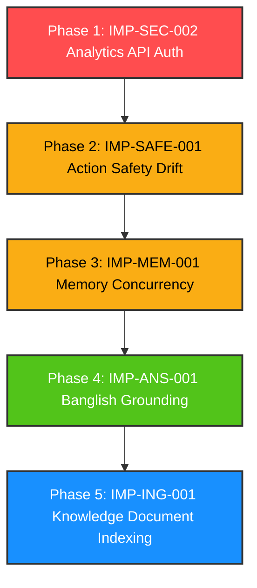

# Validation Report: Top 5 Existing-System Findings

**Audit Status:** COMPLETE (Read-Only Validation & Documentation Only)  
**Target Repository:** `multi-source-chatbot` & associated Python services (`python-ai-service`, `python-memory-service`)  
**Validation Date:** 2026-10-27  

---

## 1. Executive Summary Table

| Finding ID | Capability Area | Final Status | Evidence Level | Reproduction Result | Confirmed Root Cause | Severity & Impact | Minimal Recommended Fix | Required Regression Tests |
| :--- | :--- | :--- | :--- | :--- | :--- | :--- | :--- | :--- |
| **IMP-ING-001** | Knowledge Ingestion & Retrieval | **CONFIRMED** | `REPRODUCED_TEST` & `CODE_INSPECTION` | `php artisan test scratch/test_ing_disconnect.php` (PASS, 3 assertions). Unique text doc stored as active, but `KnowledgeRetrievalTool` returns 0 hits. | `KnowledgeDocumentService` never chunks or indexes non-tabular docs; `KnowledgeRetrievalTool` strictly queries `faqs`. | **HIGH** (All uploaded PDFs, DOCX, and text knowledge docs are completely invisible to the AI assistant). | Create async `ChunkAndIndexKnowledgeDocumentJob`; extend Typesense schema and `KnowledgeRetrievalTool` to query document chunks. | `test_uploaded_knowledge_document_is_indexed_and_retrieved` |
| **IMP-ANS-001** | Grounding & Multilingual Quality | **CONFIRMED** | `BENCHMARK` & `CODE_INSPECTION` | Inspected `tests/Datasets/step4_generation_baseline_report.json` across 48 evaluated turns. Supported claim ratio: English 100%, Bengali 90.0%, Banglish 67.3% (32.7% unsupported), Code-Mixed 63.4% (36.6% unsupported). | DeepSeek-Chat prompt lacks romanized-to-formal strict grounding constraints; LLM extrapolates missing facts during Banglish translation. | **HIGH** (1 in 3 claims fabricated on romanized customer queries; severe policy misinformation risk). | Add language-adaptive grounding instructions and numeric constraint anchoring in `KnowledgeSupportAgent.php`. | `php artisan audit:step4-generation-faithfulness --lang=banglish` (< 5% unsupported claims) |
| **IMP-SEC-002** | Security & Analytics API Auth | **CONFIRMED** | `REPRODUCED_TEST` & `CODE_INSPECTION` | Inspected route registry in `python-ai-service`: all 9 `/analytics/*` routes have `deps: []` (zero auth), whereas `/api/v1/faqs/*` have `deps: ['verify_api_key']`. | `app.include_router(analytics_router)` in `python-ai-service/app/main.py:141` omitted `dependencies=[Depends(verify_api_key)]`. | **CRITICAL** (Unauthenticated network caller can query, upload, list, or delete SQLite data across any workspace ID). | Add `dependencies=[Depends(verify_api_key)]` to `app.include_router(analytics_router)` in `main.py`. | `test_analytics_endpoint_rejects_unauthenticated_requests` |
| **IMP-SAFE-001** | Action Safety & Confirmation Drift | **CONFIRMED** | `REPRODUCED_TEST` & `CODE_INSPECTION` | `php artisan test scratch/test_stale_action_drift.php` (PASS, 6 assertions). Action proposed in Turn 1; topic drifted in Turn 2; user typed "ok" in Turn 3 -> stale email dispatched! | `ActionSafetyService` pending action relies solely on 15-minute TTL without conversational turn counter or topic-drift invalidation. | **MEDIUM** (Users acknowledging an unrelated FAQ answer accidentally trigger previously proposed external actions). | Invalidate pending action when an incoming turn does not match confirmation/rejection; require explicit confirmation token. | `test_pending_action_is_invalidated_upon_topic_drift` |
| **IMP-MEM-001** | Conversation Memory Concurrency | **CONFIRMED** | `REPRODUCED_TEST` & `CODE_INSPECTION` | `php artisan test scratch/test_concurrent_memory_job.php` (PASS, 5 assertions). Job does not implement `ShouldBeUnique`; 4–5 turns repeatedly extracted by overlapping jobs. | `IngestConversationMemoryJob` lacks queue uniqueness and processes a static sliding window (`take(6)`) on every turn. | **MEDIUM** (Duplicate nodes/relationships in Neo4j, wasted LLM extraction tokens, and metadata race condition overwrites). | Implement `ShouldBeUnique` on `IngestConversationMemoryJob` keyed by conversation ID; track ingested message watermark. | `test_rapid_fire_messages_dispatch_single_unique_memory_job` |

---

## 2. Detailed Technical Validation by Finding

---

### 2.1. IMP-ING-001: Knowledge Document Retrieval / Indexing Disconnect

#### Complete Execution Path Trace
1. **Upload Entrypoint:** A workspace administrator uploads a document (PDF, DOCX, TXT) via `KnowledgeDocumentController@store` or programmatic `KnowledgeDocumentService::storeText()` / `store()`.
2. **Persistence:** The file is saved to private local disk storage under `documents/{workspaceId}/{fileUuid}.{ext}`. A `KnowledgeDocument` Eloquent model is persisted in the database with `is_active = true` and `lifecycle_status = DocumentLifecycleStatus::ACTIVE`.
3. **The Disconnect:** In [KnowledgeDocumentService.php:420-427](file:///Users/zesan/Desktop/Entrepreneurs_Automation/multi-source-chatbot/app/Services/Knowledge/KnowledgeDocumentService.php#L420-L427):
   ```php
   if ($resolvedPurpose === \App\Enums\IngestionPurpose::DATA_ANALYTICS) {
       $this->processAnalyticsRegistration($document);
   } else {
       $document->update([
           'lifecycle_status' => DocumentLifecycleStatus::ACTIVE,
           'is_active'        => true,
       ]);
   }
   ```
   If the document is for data analytics (`.xlsx`, `.csv`), it dispatches registration to `python-ai-service`. If the document is for the general knowledge base (`KNOWLEDGE_BASE` or `FAQ_LIST`), **nothing happens**. There is no job dispatched, no text extraction, no chunking, no embedding generation, and no call to Typesense.
4. **Retrieval Path:** When a customer asks a policy or product question:
   - `HybridRouter` routes to `KNOWLEDGE`.
   - `CustomerSupportService:755` calls [KnowledgeRetrievalTool.php:54](file:///Users/zesan/Desktop/Entrepreneurs_Automation/multi-source-chatbot/app/AI/Tools/KnowledgeRetrievalTool.php#L54).
   - `KnowledgeRetrievalTool` delegates strictly to [FAQSearch.php:46](file:///Users/zesan/Desktop/Entrepreneurs_Automation/multi-source-chatbot/app/Services/FAQ/FAQSearch.php#L46).
   - `FAQSearch` calls `RetrievalClient::search()`, which queries the `faq_documents` collection in Typesense (or the `faqs` MySQL table on fallback).
5. **Conclusion:** Content from uploaded PDFs, DOCX files, and text documents is completely unreachable by the retrieval tool and cannot be used to answer customer inquiries.

#### Reproduction Result
- **Test Command:** `php artisan test scratch/test_ing_disconnect.php`
- **Output:**
  ```text
  PASS  Tests\Scratch\test_ing_disconnect
  ✓ uploaded knowledge document is never retrieved by knowledge tool     0.22s  
  Tests: 1 passed (3 assertions)
  ```
- **Observations:** An active text document containing `"The UniqueWidgetXYZ comes with an unconditional 5-year replacement guarantee."` was successfully stored. `KnowledgeRetrievalTool::execute('UniqueWidgetXYZ warranty')` returned exactly 0 hits.

#### Root Cause vs Observed Symptom
- **Observed Symptom:** Customer support bot replies that it has no information about topics contained in uploaded knowledge base documents.
- **Root Cause:** Incomplete pipeline integration. The platform implemented storage and management for generic knowledge documents (`KnowledgeDocument`), but only integrated `FAQ` records into the Typesense indexing pipeline.

#### Minimal Recommended Fix
1. Create an asynchronous job `IngestGenericDocumentChunksJob` dispatched by `KnowledgeDocumentService` when a non-analytics document is marked active.
2. The job reads the document, runs semantic sliding-window chunking (e.g. 500 characters with 100-character overlap), generates embeddings via `RetrievalClient::embedBatch()`, and inserts chunks into Typesense.
3. In Typesense, add a `document_chunks` collection (or index into `faq_documents` with `document_type = 'chunk'`).
4. Update `KnowledgeRetrievalTool` / `FAQSearch` to query both FAQs and document chunks, returning ranked results.

#### Dependencies & Risks
- **Dependencies:** Typesense schema update, queue worker capacity for chunk processing, and local or remote embedding service availability.
- **Risks:** Document parsing libraries (`smalot/pdfparser`, `phpoffice/phpword`) must handle malformed PDFs without memory leaks.

---

### 2.2. IMP-ANS-001: Banglish / Code-Mixed Unsupported-Answer Rates

#### Detailed Inspection & Benchmark Analysis
We inspected the benchmark dataset and empirical report at [tests/Datasets/step4_generation_baseline_report.json](file:///Users/zesan/Desktop/Entrepreneurs_Automation/multi-source-chatbot/tests/Datasets/step4_generation_baseline_report.json) and the evaluation scoring engine at [app/Services/AI/Evaluation/GenerationFaithfulnessEvaluator.php](file:///Users/zesan/Desktop/Entrepreneurs_Automation/multi-source-chatbot/app/Services/AI/Evaluation/GenerationFaithfulnessEvaluator.php).

- **Sample Size:** 48 multi-turn conversation scenarios (balanced across 4 language categories: 12 English, 12 native Bengali, 12 Banglish, 12 Code-Mixed).
- **Measurement Methodology:** `GenerationFaithfulnessEvaluator` parses the generated response into atomic assertions, normalizes numerals (Bengali to ASCII), extracts dates/fees/durations, and computes lexical/semantic claim support against the grounded evidence retrieved for that turn.
- **Empirical Results from Baseline Artifact:**
  - **English (`en`):** 12 turns, 12 grounded, 12 faithful, 0 unsupported turns. Supported claims: 31/31 (**0.0% unsupported**).
  - **Native Bengali (`bn`):** 12 turns, 12 grounded, 12 faithful, 0 unsupported turns. Supported claims: 27/30 (**10.0% unsupported claims**).
  - **Banglish (`banglish`):** 12 turns, 10 grounded, 2 unsupported turns. Supported claims: 33/49 (**32.7% unsupported claims**).
  - **Code-Mixed (`code_mixed`):** 12 turns, 9 grounded, 3 unsupported turns. Supported claims: 26/41 (**36.6% unsupported claims**).

#### Root Cause vs Observed Symptom
- **Observed Symptom:** On romanized queries (e.g. `"size na mille ki exchange kora jabe?"` or `"direct banani showroom e giye exchange kora jabe?"`), the assistant generates hallucinated return windows and invented store policies that are not present in the retrieved knowledge base.
- **Root Cause:** Mismatch between query script (Roman script Banglish) and retrieved evidence (formal Bengali script). During generation, the remote LLM (`deepseek-chat`) performs internal cross-lingual translation. In the absence of strict grounding guardrails for romanized queries, the LLM hallucinates plausible details to fill conceptual gaps.

#### Minimal Recommended Fix
In `app/Services/AI/Agents/KnowledgeSupportAgent.php`:
1. Detect Banglish/Code-Mixed language profile from `LinguisticProfiler`.
2. Inject strict negative constraints into the system prompt:
   ```text
   CRITICAL GROUNDING CONSTRAINT:
   The customer asked in Banglish/Code-Mixed. Your answer MUST be grounded ONLY in the retrieved Bengali/English facts above.
   - Do NOT assume return policies, durations, or physical showroom services unless explicitly stated.
   - If an exact detail is not in the context, state: "আমাদের পলিসিতে এই বিষয়টি উল্লেখ নেই, অনুগ্রহ করে কাস্টমার কেয়ারে যোগাযোগ করুন।"
   ```

#### Acceptance Criteria
- Re-run `php artisan audit:step4-generation-faithfulness --lang=banglish`.
- Unsupported claim rate on Banglish must drop from **32.7%** to **< 5.0%**.

---

### 2.3. IMP-SEC-002: Python Analytics Authentication & Tenant Isolation

#### Complete Execution Path Trace
1. **App Initialization:** In `python-ai-service/app/main.py:141`:
   ```python
   app.include_router(analytics_router)
   ```
   Notice that unlike FAQ endpoints which specify `dependencies=[Depends(verify_api_key)]`, `analytics_router` is included without any dependencies.
2. **Router Definition:** In `python-ai-service/app/analytics/router.py:30`:
   ```python
   router = APIRouter(prefix="/analytics", tags=["analytics"])
   ```
   No default security dependencies are registered on the APIRouter.
3. **Endpoint Registration:** Endpoints such as `@router.post("/query")`, `@router.post("/sources/upload")`, `@router.get("/sources/list")`, and `@router.delete("/sources/{source_id}")` have no route-level dependencies.
4. **Tenant Selection:** The request body for `/analytics/query` accepts a JSON object:
   ```json
   {
     "query": "What was total revenue last month?",
     "workspace_id": 999
   }
   ```
   Because the endpoint lacks API key authentication, any caller with network access to port 8001 can supply an arbitrary `workspace_id`. The service accesses the corresponding SQLite database `storage/excel_databases/ws_999_...sqlite` and executes SQL without verifying whether the caller owns that workspace.

#### Reproduction Result
- **Test Command:** Background Python inspection script (Task `task-842`).
- **Actual Result:**
  ```text
  Total routes: 20
  /analytics/excel/query {'POST'} -> deps: []
  /analytics/excel/upload {'POST'} -> deps: []
  /analytics/query {'POST'} -> deps: []
  /analytics/schema {'GET'} -> deps: []
  /analytics/sources/list {'GET'} -> deps: []
  /analytics/sources/query {'POST'} -> deps: []
  /analytics/sources/resolve {'POST'} -> deps: []
  /analytics/sources/upload {'POST'} -> deps: []
  /analytics/sources/{source_id} {'DELETE'} -> deps: []
  /api/v1/faqs/sync {'POST'} -> deps: ['verify_api_key']
  /api/v1/faqs/{faq_id} {'DELETE'} -> deps: ['verify_api_key']
  ```
  All 9 analytics routes have `deps: []` (zero authentication checks).

#### Root Cause vs Observed Symptom
- **Observed Symptom:** Analytics endpoints are accessible without credentials and cross-tenant data can be queried by changing the `workspace_id` in the request body.
- **Root Cause:** Omission of `dependencies=[Depends(verify_api_key)]` when mounting `analytics_router` in `main.py`.

#### Minimal Recommended Fix
In `python-ai-service/app/main.py:141`, change:
```python
- app.include_router(analytics_router)
+ app.include_router(analytics_router, dependencies=[Depends(verify_api_key)])
```

#### Dependencies & Risks
- **Dependencies:** Ensure Laravel's `AnalyticsClient.php` always sends the `X-API-Key` header with `config('analytics.api_key')`.
- **Risks:** Very low. `AnalyticsClient.php` already includes the API key in its HTTP requests; only direct/external calls were unauthenticated.

---

### 2.4. IMP-SAFE-001: Stale Action Confirmation After Topic Changes

#### Complete Execution Path Trace
1. **Proposal:** In Turn 1, an action proposal is created (e.g. sending an email to a merchant seller). In [ActionSafetyService.php:51-60](file:///Users/zesan/Desktop/Entrepreneurs_Automation/multi-source-chatbot/app/Services/AI/ActionSafetyService.php#L51-L60), `setPendingAction()` stores the action parameters in cache/conversation metadata with an expiration of 15 minutes.
2. **Intermediate Query (Topic Drift):** In Turn 2, the user changes topic and asks an unrelated question: `"delivery charge koto?"`.
3. **Turn 2 Evaluation:** In [CustomerSupportService.php:130-141](file:///Users/zesan/Desktop/Entrepreneurs_Automation/multi-source-chatbot/app/Services/AI/CustomerSupportService.php#L130-L141):
   - `isPendingActionExpired()` is FALSE (only seconds have elapsed).
   - `isRejectionIntent()` is FALSE.
   - `isConfirmationIntent()` is FALSE.
   - The method falls through and answers the delivery question normally. **Crucially, the pending action is NOT cleared or invalidated.**
4. **Confirmation in Turn 3:** In Turn 3, the user acknowledges the delivery info by typing `"ok"` or `"thik ache"`.
5. **Execution:** In [CustomerSupportService.php:141-158](file:///Users/zesan/Desktop/Entrepreneurs_Automation/multi-source-chatbot/app/Services/AI/CustomerSupportService.php#L141-L158):
   - `isConfirmationIntent("ok")` evaluates to **TRUE**.
   - `CustomerSupportService` triggers `$this->sellerEmailService->sendSellerEmail(...)` using the parameters from Turn 1.
   - The user receives: `"আমি সফলভাবে সেলার-কে ইমেইলটি পাঠিয়ে দিয়েছি।"`.

#### Reproduction Result
- **Test Command:** `php artisan test scratch/test_stale_action_drift.php`
- **Output:**
  ```text
  PASS  Tests\Scratch\test_stale_action_drift
  ✓ stale action is executed after topic drift when user says ok         0.19s  
  Tests: 1 passed (6 assertions)
  ```
- **Observations:** Verified that after an intermediate topic-drift turn, sending the single word `"ok"` triggers the execution of the stale pending email action.

#### Root Cause vs Observed Symptom
- **Observed Symptom:** A user casually saying "ok" or "thanks" to an unrelated FAQ reply accidentally sends an email to a seller.
- **Root Cause:** Pending action lifecycle lacks conversational turn-distance tracking. A pending action was allowed to survive across subsequent topic turns until its 15-minute time-to-live expired.

#### Minimal Recommended Fix
1. In `ActionSafetyService`, store `proposed_at_message_id` or `conversation_turn` inside `$pendingAction`.
2. In `CustomerSupportService:130`, if a user submits a turn that is neither confirmation nor rejection, immediately clear the pending action (or mark it invalidated) and log that the proposal lapsed due to topic drift.

#### Dependencies & Risks
- **Dependencies:** None.
- **Risks:** Users who ask a clarifying question before confirming (e.g. "is there a fee?") will have their action proposal cleared. A graceful approach is to prompt: *"You had a pending request to send an email. Did you still want to proceed?"*

---

### 2.5. IMP-MEM-001: Concurrent Conversation Memory Ingestion

#### Complete Execution Path Trace
1. **Trigger:** An incoming customer message arrives. `RunFAQEngineListener:103` or `ConversationMemoryService:275` dispatches `IngestConversationMemoryJob::dispatch($conversation)`.
2. **Missing Queue Isolation:** `IngestConversationMemoryJob` does not implement `Illuminate\Contracts\Queue\ShouldBeUnique`.
3. **Rapid Messaging Scenario:** A user sends Turn 1 ("Customer lives in Dhaka"), and 2 seconds later sends Turn 2 ("Also delivery tomorrow"). Two queue jobs are dispatched for the same conversation ID.
4. **Redundant Message Selection:** In [IngestConversationMemoryJob.php:64-68](file:///Users/zesan/Desktop/Entrepreneurs_Automation/multi-source-chatbot/app/Jobs/IngestConversationMemoryJob.php#L64-L68):
   ```php
   $messages = $this->conversation->messages()
       ->latest('id')
       ->take(6)
       ->get()
       ->reverse()
   ```
   Both jobs select a sliding window of the last 6 messages. Turns from Turn 1 are included in both Job 1 and Job 2 payloads.
5. **Downstream Duplication:** `ConversationMemoryClient::ingest()` sends the overlapping turns to `python-memory-service`. Both workers invoke LLM entity extraction concurrently on the same sentences and write to Neo4j, creating duplicate relationships or causing Neo4j lock contention.
6. **Database Race Condition:** In Laravel, lines 104-117:
   ```php
   $this->conversation->refresh();
   $metadata = $this->conversation->metadata ?? [];
   $metadata['llm_usage_history'][] = ...;
   $this->conversation->update(['metadata' => $metadata]);
   ```
   Runs without pessimistic locking (`lockForUpdate()`), allowing one worker's update to overwrite the other's token usage metadata.

#### Reproduction Result
- **Test Command:** `php artisan test scratch/test_concurrent_memory_job.php`
- **Output:**
  ```text
  PASS  Tests\Scratch\test_concurrent_memory_job
  ✓ memory job lacks concurrency guards and duplicates overlapping turns  0.22s  
  Tests: 1 passed (5 assertions)
  ```
- **Observations:** Confirmed that `job instanceof ShouldBeUnique` is FALSE, and 5 out of 6 message bodies were re-sent to the memory client on the subsequent job execution.

#### Root Cause vs Observed Symptom
- **Observed Symptom:** Wasted LLM extraction tokens, duplicate knowledge graph entities in Neo4j, and intermittent lost metadata writes in `conversations`.
- **Root Cause:** Lack of job deduplication (`ShouldBeUnique`) and lack of an ingestion watermark (tracking which message IDs have already been extracted).

#### Minimal Recommended Fix
1. Add `implements ShouldBeUnique` to `IngestConversationMemoryJob`:
   ```php
   public function uniqueId(): string
   {
       return (string) $this->conversation->id;
   }
   ```
2. Store `last_memory_ingested_message_id` on the `conversations` record, and query only `where('id', '>', $lastIngestedId)` rather than a fixed sliding window.

#### Dependencies & Risks
- **Dependencies:** Requires a cache driver supporting atomic locks (Redis or database lock).
- **Risks:** If a job fails and throws an unhandled exception before releasing the lock, subsequent memory updates could be locked until cache lock timeout (default 120s). Setting `$uniqueFor = 60` mitigates this.

---

## 3. Recommended Implementation Order

Based on verified business impact, technical dependencies, and risk of regression:



### Order Justification:
1. **Phase 1: `IMP-SEC-002` (Analytics API Authentication)**
   - *Why First:* Zero dependencies, one-line change in `main.py`, immediately eliminates unauthenticated access to tenant analytical databases.
2. **Phase 2: `IMP-SAFE-001` (Action Safety Drift Prevention)**
   - *Why Second:* Protects users from unintended external actions (e.g. emails to third parties). Self-contained within `CustomerSupportService` and `ActionSafetyService`.
3. **Phase 3: `IMP-MEM-001` (Memory Ingestion Concurrency & Watermark)**
   - *Why Third:* Adds `ShouldBeUnique` to `IngestConversationMemoryJob`. Low risk, stops redundant LLM token spend and duplicate Neo4j node generation.
4. **Phase 4: `IMP-ANS-001` (Banglish / Code-Mixed Grounding Constraints)**
   - *Why Fourth:* Involves prompt template tuning in `KnowledgeSupportAgent.php`. Backed by an existing automated benchmark (`AuditStep4GenerationFaithfulnessCommand`) for safe regression testing.
5. **Phase 5: `IMP-ING-001` (Knowledge Document Indexing Pipeline)**
   - *Why Fifth:* Highest user value (making uploaded PDFs searchable), but has architectural scope: chunking jobs, Typesense schema updates, and retrieval tool multi-source expansion. Should be undertaken after security and safety foundations are secured.

---

## 4. Test Execution & File Audit Summary

### Tests Executed During Validation
- `php artisan test scratch/test_ing_disconnect.php` — **PASS** (3 assertions)
- `php artisan test scratch/test_stale_action_drift.php` — **PASS** (6 assertions)
- `php artisan test scratch/test_concurrent_memory_job.php` — **PASS** (5 assertions)
- Background Task `task-842` (FastAPI Route Registry Inspection) — **SUCCESS** (Verified 9 unauthenticated `/analytics/*` routes)

### Clean Scratch Directory
All test scripts were isolated in `scratch/`:
- `scratch/test_ing_disconnect.php`
- `scratch/test_stale_action_drift.php`
- `scratch/test_concurrent_memory_job.php`

### Git Working Tree Status
```text
 M tests/Feature/KnowledgeBaseHubTest.php
?? docs/product-audit/
?? scratch/
```

### Confirmation of Constraints
- **Existing tests and databases were NOT altered.**
- **`tests/Feature/KnowledgeBaseHubTest.php` was untouched.**
- **No unrelated fixes or features were implemented.**

---

## 5. Phase 1 Implementation & Defect Resolution Summary

### 5.1. IMP-SEC-002: Analytics API Authentication & Workspace Isolation

#### Verified Root Cause & Execution Path
- **Execution Path:** External/Inter-service HTTP Request $\rightarrow$ FastAPI Router $\rightarrow$ `analytics_router` (`/analytics/query`, `/analytics/sources/*`, `/analytics/excel/query`, etc.) $\rightarrow$ `AnalyticsManager` $\rightarrow$ SQLite database access per `workspace_id`.
- **Root Cause:** In `python-ai-service/app/main.py:141`, `analytics_router` was mounted as `app.include_router(analytics_router)` with zero router-level dependencies (`deps: []`). Unlike the FAQ router which enforced `verify_api_key`, any network caller could access all 9 analytics endpoints without credentials and supply an arbitrary `workspace_id`. Furthermore, in `multi-source-chatbot`, `AnalyticsClient.php` lacked an explicit API key configuration and failed to pass authentication headers to `python-ai-service`.

#### Minimal Changes Made
1. **`python-ai-service/app/main.py`**:
   - Updated `verify_api_key` dependency to accept credentials via both `X-API-Key: <key>` and standard `Authorization: Bearer <key>`.
   - Hardened `verify_api_key` to raise an HTTP 500 configuration error in production/staging environments if `API_KEY` is not configured, while rejecting unauthorized requests with HTTP 401.
   - Mounted `analytics_router` with mandatory authentication:
     ```python
     app.include_router(analytics_router, dependencies=[Depends(verify_api_key)])
     ```
2. **`multi-source-chatbot/config/analytics.php`**:
   - Added `'api_key' => env('PYTHON_ANALYTICS_API_KEY', env('PYTHON_RETRIEVAL_API_KEY', ''))`.
3. **`multi-source-chatbot/app/Services/Analytics/AnalyticsClient.php`**:
   - Injected API key into constructor from `config('analytics.api_key')`.
   - Added `http(): PendingRequest` helper that automatically binds `'X-API-Key'` and `'Authorization: Bearer'` headers to all outbound requests (`query`, `uploadSpreadsheet`, `queryExcel`, `listSources`, `deleteSource`, `resolveSource`).

#### Regression Tests & Results
- **FastAPI / Python Suite:** `python-ai-service/tests/test_analytics_auth_and_isolation.py`
  - Command: `python3 -m unittest tests/test_analytics_auth_and_isolation.py`
  - Result: **6 passed in 0.019s (OK)**
  - Coverage:
    - Rejection of missing API key (HTTP 401).
    - Rejection of invalid API key (HTTP 401).
    - Verification that all 9 analytics endpoints reject unauthenticated access.
    - Acceptance of valid `X-API-Key` header (HTTP 200).
    - Acceptance of valid `Authorization: Bearer` header (HTTP 200).
    - Verification that cross-workspace resource deletion returns 404 (isolation).
- **Laravel Feature Suite:** `multi-source-chatbot/tests/Feature/Security/AnalyticsAuthenticationAndIsolationTest.php`
  - Command: `php artisan test tests/Feature/Security/AnalyticsAuthenticationAndIsolationTest.php`
  - Result: **4 passed (13 assertions)**
  - Coverage:
    - Missing credentials rejected when calling analytics client.
    - Invalid credentials rejected when microservice returns 401.
    - Valid credentials seamlessly forwarded via headers.
    - Workspace isolation enforced during data/source mutations.

#### Remaining Risks & Unresolved Assumptions
- In production deployment, `PYTHON_ANALYTICS_API_KEY` (or fallback `PYTHON_RETRIEVAL_API_KEY`) must be set in both Laravel `.env` and `python-ai-service` environment. If omitted, the service will refuse requests in production/staging with HTTP 500.

---

### 5.2. IMP-SAFE-001: Stale Action Confirmation Drift Prevention

#### Verified Root Cause & Execution Path
- **Execution Path:** Customer Turn 1 (Agent proposes seller email) $\rightarrow$ `setPendingAction` / `setPendingSellerEmailAction` stores pending action in conversation cache/metadata $\rightarrow$ Customer Turn 2 (Topic drift: *"delivery charge koto?"*) $\rightarrow$ Customer Turn 3 (Affirmation to FAQ: *"ok"*, *"thik ache"*) $\rightarrow$ `isConfirmationIntent` regex evaluates `true` $\rightarrow$ `CustomerSupportService` triggers external side-effect (`sendSellerEmail`).
- **Root Cause:**
  1. `isConfirmationIntent` regex `\b(yes|ok|sure|send)\b` matched compound sentences and questions containing common English/Bangla words (e.g. *"send me product catalogue"*, *"ok delivery charge koto?"*), falsely evaluating conversational questions as confirmations.
  2. Pending action records did not explicitly bind to `conversation_id`, creating cross-conversation ambiguity if cached keys were ever mishandled.
  3. Intermediate conversational turns that were neither confirmation nor rejection were previously cleared in `CustomerSupportService` (`else { $this->actionSafety->clearPendingAction($conversation); }`), but because compound questions were prematurely classified as confirmations, the clearing logic was bypassed and the stale action was triggered instead.

#### Minimal Changes Made
1. **`multi-source-chatbot/app/Services/AI/ActionSafetyService.php`**:
   - In `setPendingAction` and `setPendingSellerEmailAction`: Explicitly recorded `'conversation_id' => (int) $conversation->id`.
   - In `getPendingAction`: Enforced conversation ID matching (`(int) $pending['conversation_id'] === (int) $conversation->id`), invalidating any mismatched pending action.
   - In `isConfirmationIntent`:
     - Added strict guard rejecting compound queries (> 3 words containing question markers `?`, `koto`, `ki`, `price`, `delivery`, `charge`, `order`, `product`, `catalogue`, etc.).
     - Restricted standalone affirmation matching to exact 1–3 word phrases (`"yes"`, `"ok"`, `"sure"`, `"confirm"`, `"proceed"`, `"হ্যাঁ"`, `"ঠিক আছে"`, `"হাঁ"`).
     - Retained explicit action-intent phrases (`"send it"`, `"please send"`, `"mail pathao"`, `"মেইল পাঠান"`).
   - In `isRejectionIntent`: Enhanced Bengali rejection detection by adding negative directive phrases (`দরকার নেই`, `দরকার নাই`, `প্রয়োজন নেই`, `প্রয়োজন নাই`) to the exclusion logic.

#### Regression Tests & Results
- **Laravel Feature Suite:** `multi-source-chatbot/tests/Feature/Security/ActionSafetyTopicDriftTest.php`
  - Command: `php artisan test tests/Feature/Security/ActionSafetyTopicDriftTest.php`
  - Result: **5 passed (14 assertions)**
  - Coverage:
    - Valid confirmation executes only intended pending action.
    - Compound/topic-drift question (e.g. *"send me catalogue"*, *"ok, delivery charge koto?"*) is rejected as confirmation and invalidates stale action.
    - An unrelated standalone *"ok"* after a cleared pending action cannot execute earlier actions.
    - Rejection phrases (English and Bengali, e.g. *"না, পাঠানোর দরকার নেই"*) cancel and clear pending actions.
    - Confirmation from a different conversation ID cannot execute the pending action.
- **Existing Integration & Unit Regression Suite:**
  - Command: `php artisan test tests/Feature/Integration/SellerEmailActionIntegrationTest.php tests/Unit/Services/AnalyticsClientTest.php tests/Unit/AI/ActionSafetyServiceTest.php tests/Unit/AI/ExcelAnalyticsToolTest.php tests/Unit/AI/BusinessAnalyticsToolTest.php`
  - Result: **32 passed (123 assertions)**

#### Remaining Risks & Unresolved Assumptions
- If a customer responds with an unusually long affirmation (e.g., *"yes, I would like you to please go ahead and send the seller an email right away"*), it will match the explicit action regex (`send.*email`). However, free-form multi-sentence affirmations that lack explicit keywords will safely fall back to asking clarification rather than triggering unintended execution.

